# ACCERO PRINTPORTAL - INTERNAL LINKING ARCHITECTURE & TOPICAL GRAPH

**Canonical Domain:** `https://printportal.accero.app`  
**Purpose:** Establish optimal link equity flow, eliminate orphan pages, and provide intuitive user navigation across commercial and informational pages.

---

## 1. HIERARCHICAL TOPOLOGY

```mermaid
flowchart TD
    Home["Homepage (/)"]

    Home --> Features["/features"]
    Home --> Services["/services"]
    Home --> Solutions["/solutions"]
    Home --> Pricing["/pricing"]
    Home --> Resources["/resources"]
    Home --> Blog["/blog"]
    Home --> FAQ["/faq"]
    Home --> About["/about"]
    Home --> Contact["/contact"]

    Features --> F1["/features/document-lookup"]
    Features --> F2["/features/document-editing"]
    Features --> F3["/features/multilingual-printing"]
    Features --> F4["/features/document-printing"]
    Features --> F5["/features/document-management"]
    Features --> F6["/features/wallet-management"]

    Services --> S1["/services/pan-card-printing"]
    Services --> S2["/services/aadhaar-document-management"]
    Services --> S3["/services/voter-id-printing"]
    Services --> S4["/services/driving-licence-printing"]
    Services --> S5["/services/vehicle-rc-printing"]
    Services --> S6["/services/ration-card-management"]

    Solutions --> Sol1["/solutions/cyber-cafes"]
    Solutions --> Sol2["/solutions/csc-operators"]
    Solutions --> Sol3["/solutions/printing-shops"]
    Solutions --> Sol4["/solutions/digital-service-centers"]

    Blog --> B1["/blog/cr80-card-dimensions-guide"]
    Blog --> B2["/blog/pvc-card-printer-tray-guide"]
    Blog --> B3["/blog/cyber-cafe-document-printing-guide"]
```

---

## 2. SITEWIDE LINKING HUBS

### A. Public Navbar (`src/components/layout/PublicNavbar.tsx`)
Desktop and mobile navigation menus provide direct 1-click access to the top 5 high-value public sections:
- **Features:** `/features`
- **Services:** `/services`
- **Solutions:** `/solutions`
- **Pricing:** `/pricing`
- **FAQ:** `/faq`
- **CTA:** `/register` (Get Started) & `/login` (Operator Sign In)

*(Note: The previous broken link to `/cards` which hit an authentication redirect has been completely replaced with public `/features`).*

### B. Global Footer (`src/components/layout/Footer.tsx`)
The footer provides structured multi-column crawling pathways:
- **Supported Documents (6 links):** Deep links to all 6 service landing pages.
- **Platform Features (6 links):** Deep links to all 6 specialized feature pages.
- **Operator Solutions (6 links):** Links to Cyber Cafes, CSC Operators, Printing Shops, Digital Service Centers, Pricing, and Operator FAQ.
- **Company & Legal (6 links):** About, Contact, Blog, Security, Privacy Policy, Terms of Service.
- **Utility Links:** Sitemap (`/sitemap.xml`) and LLM Manifest (`/llms.txt`).

---

## 3. CONTEXTUAL & IN-CONTENT LINKING MATRIX

| Page Type | Source Page | Outbound Internal Links | Anchor Text Pattern |
|---|---|---|---|
| **Service Detail** | `/services/pan-card-printing` | Cross-Service Links (Aadhaar, Voter, DL, RC, Ration Card) | `Aadhaar PVC Card`, `Voter ID (EPIC)` |
| **Service Detail** | `/services/*` | `/features/document-lookup`, `/studio` | `Split-Screen Studio`, `Instant Lookup` |
| **Feature Page** | `/features/document-printing` | `/blog/cr80-card-dimensions-guide`, `/services/pan-card-printing` | `CR80 Dimensions Guide`, `PAN Card Print` |
| **Feature Page** | `/features/document-lookup` | `/services/*`, `/features/document-editing` | `Supported Services`, `Split-Screen Live Editor` |
| **Solution Page** | `/solutions/cyber-cafes` | `/services/pan-card-printing`, `/services/voter-id-printing`, `/pricing` | `PAN Card Print`, `Voter ID Print`, `Pricing Details` |
| **Solution Page** | `/solutions/csc-operators` | `/services/ration-card-management`, `/features/multilingual-printing` | `Ration Card Management`, `Bilingual Printing` |
| **Blog Cornerstone**| `/blog/cr80-card-dimensions-guide` | `/features/document-printing`, `/services/pan-card-printing`, `/register` | `CR80 Card Print Engine`, `PVC PAN Card Print` |
| **Blog Cornerstone**| `/blog/pvc-card-printer-tray-guide` | `/blog/cr80-card-dimensions-guide`, `/solutions/printing-shops` | `CR80 Dimensions Guide`, `For Printing Shops` |

---

## 4. ANCHOR TEXT & BREADCRUMB GUIDELINES

1. **Descriptive Anchor Text:** Never use generic "click here" or "learn more" without context. Use descriptive phrases: e.g., *"Read the full CR80 Card Dimensions Guide"* or *"Explore Ration Card Management"*.
2. **Breadcrumb Uniformity:** All sub-pages implement HTML breadcrumbs and Schema.org `BreadcrumbList` linking upwards to Category hubs and Homepage.
3. **Zero Orphan Pages Guarantee:** Every indexable public URL is reachable within a maximum of 2 clicks from the homepage or global navigation.

