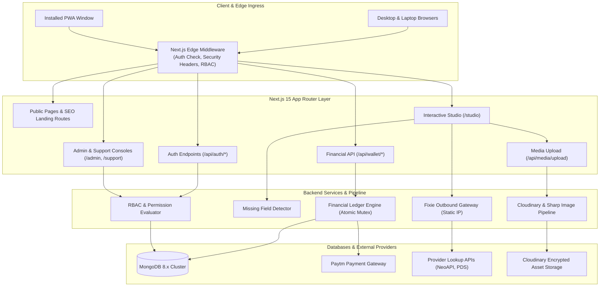

# Accero PrintPortal

> **Accero PrintPortal** is an independent, high-performance document-processing and PVC card printing platform designed for Common Service Centre (CSC) operators, cyber cafes, digital service centers, and retail printing kiosks across India.

[](https://nextjs.org/)
[](https://react.dev/)
[](https://www.typescriptlang.org/)
[](https://tailwindcss.com/)
[](https://www.mongodb.com/)
[-navy)](https://en.wikipedia.org/wiki/ISO/IEC_7810)
[](docs/pwa/architecture.md)
[-success?logo=vitest)](tests)
[](https://vercel.com/)

**Production Website:** [https://printportal.accero.app](https://printportal.accero.app)  
**Project Version:** `1.0.0` (Production Ready)  
**Main Documentation Hub:** [docs/README.md](docs/README.md)  

> [!IMPORTANT]
> **Statutory Disclaimer & Non-Affiliation:** Accero PrintPortal is an independent commercial utility and document formatting software platform. It is not affiliated with, authorized by, sponsored by, or endorsed by the Unique Identification Authority of India (UIDAI), the Income Tax Department, the Election Commission of India (ECI), the Ministry of Road Transport and Highways (MoRTH), the Department of Food and Public Distribution, or any Central or State Government authority. All statutory identity documents remain the exclusive property of their respective issuing bodies.

---

## Table of Contents

- [About Accero PrintPortal](#about-accero-printportal)
  - [What the Platform Does](#what-the-platform-does)
  - [Who It Serves](#who-it-serves)
  - [The Business Problem Addressed](#the-business-problem-addressed)
  - [Document Processing & Printing Workflow](#document-processing--printing-workflow)
- [Key Features](#key-features)
  - [Document Processing Services](#document-processing-services)
  - [Document Management & Interactive Studio](#document-management--interactive-studio)
  - [Precision Printing & PDF Pipeline](#precision-printing--pdf-pipeline)
  - [Progressive Web App (PWA) Capabilities](#progressive-web-app-pwa-capabilities)
  - [Business Operations & Financial Ledger](#business-operations--financial-ledger)
- [Technology Stack](#technology-stack)
- [System Architecture](#system-architecture)
  - [Architecture Overview](#architecture-overview)
  - [System Flow Diagram](#system-flow-diagram)
- [Project Directory Structure](#project-directory-structure)
- [Prerequisites](#prerequisites)
- [Local Development Setup](#local-development-setup)
- [Environment Configuration](#environment-configuration)
- [Development Commands](#development-commands)
- [Architecture & Technical Documentation Index](#architecture--technical-documentation-index)
- [Security and Privacy](#security-and-privacy)
- [Testing and Quality Assurance](#testing-and-quality-assurance)
- [Deployment](#deployment)
- [Contribution and Development Guidelines](#contribution-and-development-guidelines)
- [Support and Troubleshooting](#support-and-troubleshooting)
- [License and Ownership](#license-and-ownership)

---

## About Accero PrintPortal

### What the Platform Does
Accero PrintPortal provides a high-performance web gateway for commercial document processing. It transforms raw government document lookups or manual data entries into pixel-perfect, **ISO/IEC 7810 ID-1 (CR80)** standard physical card layouts, enabling instant dual-sided card printing and high-DPI PDF generation.

### Who It Serves
- **CSC Village Level Entrepreneurs (VLEs)** handling morning citizen documentation footfalls.
- **Cyber Cafe Operators & Retail Printing Kiosks** printing PVC ID cards for walk-in clients.
- **Digital Document Centers** requiring standardized, error-free formatting tools.
- **Document Retailers** needing fast, reliable verification and reprint tools.

### The Business Problem Addressed
Legacy print portals in India suffer from recurring structural defects:
1. **Unstable Upstream Gateways & 502 Crashes:** Legacy single-VPS portals collapse during morning rush hours when citizen footfall is highest.
2. **Blind Print Failures & Ruined Blanks:** External government APIs frequently return partial or empty fields (e.g. missing father's name, missing date of birth). Traditional software prints these truncated payloads directly, ruining expensive physical PVC card blanks.
3. **Wallet Balance Losses:** Legacy scripts deduct user balances without guaranteeing print success and fail to offer compensations when external providers timeout.
4. **Distorted Regional Typography:** Regional scripts (Hindi, Tamil, Telugu, Gujarati, Bengali, Marathi) frequently suffer from font overlap, clipped glyphs, or broken Devanagari ligatures.

Accero PrintPortal solves these problems through **multi-provider verification cascades**, an **interactive split-screen Studio** with real-time missing field detection, a **72-hour tenant-isolated document cache**, **atomic ACID wallet transactions**, and **native vector typography rendering**.

### Document Processing & Printing Workflow
```
[Operator Input: Card No. or Manual]
               │
               ▼
   [Provider Lookup Cascade] ──(Fallback)──► [Manual Entry Mode]
               │
               ▼
[Interactive Split-Screen Studio]
  ├── Left: Form Editor & Photo/Sig Dropzone
  ├── Real-time Missing Field Detection & Health Score
  └── Right: Live Dual-Sided CR80 Preview
               │
               ▼
 [Operator Verification & Balance Check]
               │
               ▼
 [Atomic Wallet Deduction & 72h Cache Save]
               │
               ▼
[Physical Printing: Card Tray (@media print) or High-DPI PDF Export]
```

---

## Key Features

### Document Processing Services
The platform provides preformatted, official-standard card canvases for seven core citizen document categories:

| Document Type | Canvas Component | Format & Verification Features |
| :--- | :--- | :--- |
| **PAN Card** | `PanCardCanvas.tsx` | NSDL/UTIITSL format, dynamic QR code generation, photo/signature upload, ITD styling. |
| **Aadhaar Card** | `AadhaarCardCanvas.tsx` | UIDAI layout standard, optional 12-digit privacy masking, bilingual address formatting, secure 2D QR. |
| **Voter ID (EPIC)** | `VoterCardCanvas.tsx` | ECI layout, bilingual headings, assembly constituency metadata, Code-128 barcode + QR. |
| **Driving Licence** | `DlCardCanvas.tsx` | State Transport Department layout, vehicle class authorization grid (MCWG, LMV), badge numbers. |
| **Vehicle RC** | `RcCardCanvas.tsx` | MoRTH smart card specification, simulated IC chip graphic, vehicle technical parameters, fuel type. |
| **Ration Card** | `RationCardCanvas.tsx` | NFSA standard, state emblem selection, family member allocation grid, FPS shop code, AAY/PHH badges. |
| **Farmer ID** | `FarmerCardCanvas.tsx` | AgriStack / State Farmer Registry format, landholding parcel grid (khata, khasra, area), regional localization. |

### Document Management & Interactive Studio
- **Multi-Provider Lookup Cascade:** Orchestrated queries across upstream providers (NeoAPI, FastNexora) with automatic timeout detection and graceful fallback.
- **Manual Data Entry Mode:** Full manual input forms for operators handling offline documentation or direct customer-provided details.
- **Split-Screen Interactive Studio:** Real-time synchronized editing where form updates immediately reflect on the adjacent live CR80 canvas.
- **Missing-Field Visibility Engine:** Declarative heuristic rules (`src/lib/missingFields.ts`) evaluate incoming payloads, highlighting missing fields with amber indicators and calculating a completion score prior to print authorization.
- **72-Hour Tenant-Isolated Cache:** Documents are persisted in MongoDB (`DocumentRecord`) with a 72-hour TTL index. Operators can re-edit, preview, or re-print documents within 72 hours without incurring additional verification fees.

### Precision Printing & PDF Pipeline
- **ISO/IEC 7810 ID-1 Standard:** Canvas containers strictly honor physical card geometry ($85.60\text{ mm} \times 53.98\text{ mm}$, 3.18 mm rounded corners).
- **High-DPI PDF Export:** Client-side 3x rasterization (`html2canvas`) paired with `jspdf` generates crisp, vector-accurate two-page landscape PDFs ready for production printing.
- **Physical Card Tray Alignment:** Dedicated `@media print` CSS rules isolate the card elements, hide navigation chrome, and space cards precisely for standard dual-card PVC printer trays (e.g. Epson L805).
- **Multilingual Rendering:** Embedded Google Fonts (`Hind`, `Roboto`, `Open Sans`) ensure proper typography rendering across Hindi, Marathi, Tamil, Telugu, Gujarati, Punjabi, Bengali, and Kannada.

### Progressive Web App (PWA) Capabilities
- **Cross-Platform Installability:** Installs as a standalone business desktop/mobile application across Windows 10/11, macOS, Android, and iOS/iPadOS without app store dependencies.
- **W3C Web App Manifest:** Configured via `src/app/manifest.ts` with brand theming (`#8B1E2D`), standalone display mode, adaptive icons, and quick-launch shortcuts.
- **Zero-Trust Caching Engine:** Custom service worker (`public/sw.js`) precaches the application shell while strictly enforcing **Network-Only** access for all sensitive API endpoints, authentication sessions, and citizen document data.
- **Graceful Offline Fallback:** Dedicated `/offline` route with real-time connectivity status and retry controls.
- **Platform-Aware Install UI:** Header install button with responsive text and an iOS installation modal guiding operators through Safari Share Sheet setup.

### Business Operations & Financial Ledger
- **Universal Authentication & RBAC:** Single sign-on entry point with 7-day secure JWT cookies. 5-tier role hierarchy: `super_admin`, `admin`, `support_manager`, `support_agent`, and `operator`.
- **Prepaid Wallet Ledger:** Atomic wallet debits using MongoDB ACID transactions, enforcing the Balance Conservation Law ($Balance \ge 0$).
- **Instant Recharge via Paytm:** Dynamic UPI QR code generation, multi-merchant routing configuration (`PAYTM_ACCOUNTS`), and automated server-to-server transaction status verification.
- **Manual Recharge Workflow:** Operators can submit bank transfer UTR numbers for manual administrative review and credit approval.
- **Promo Code & Coupon System:** Supports percentage and flat wallet discounts, maximum discount caps, usage limits, and campaign expiration tracking.
- **Referral Rewards Program:** Two-tier referral tracking awarding automatic bonus wallet credits upon referee qualification.
- **Customer Support Portal:** Integrated ticketing workflow with priority assignment, message threads, and operator account lookup for support staff.

---

## Technology Stack

| Layer | Technology | Version | Purpose |
| :--- | :--- | :--- | :--- |
| **Framework** | Next.js (App Router) | `15.1.7` | Server Components, Route Handlers, Server Actions, Dynamic Metadata |
| **Frontend Runtime** | React | `19.0.0` | Declarative UI, Concurrent Rendering, Optimistic UI updates |
| **Language** | TypeScript | `5.7.3` | Strict type safety across document schemas, financial ledgers, and API responses |
| **Styling** | Tailwind CSS | `3.4.17` | Utility-first design system with custom brand tokens (`brand-navy`, `accent-amber`) |
| **Database** | MongoDB | `8.x` / Mongoose `9.10.2` | Persistent storage, document versioning, user sessions, audit logs, and ledger events |
| **Media Pipeline** | Cloudinary & Sharp | Sharp `0.35.5` / SDK `2.11.0` | Server-side image optimization, background removal, photo cropping, and secure delivery |
| **Outbound Proxy** | Fixie Proxy Agent | `https-proxy-agent` `9.1.0` | Static outbound IP routing for whitelisted government data provider APIs |
| **Authentication** | `jose` JWT & bcryptjs | `jose` `6.2.12` / `bcryptjs` `3.0.3` | Cryptographic session tokens, HTTP-only cookie guards, and 5-tier RBAC |
| **Payments** | Paytm Payment Gateway | Custom Node integration | Checksum-verified UPI, NetBanking, and Wallet recharge order flows |
| **Document Export** | jsPDF & html2canvas | `jspdf` `4.2.1` / `html2canvas` `1.4.1` | Client-side vector and raster PDF generation matching CR80 card trays |
| **Rate Limiting** | Upstash Redis & MongoDB | `@upstash/ratelimit` `2.2.0` | Sliding-window IP and token-based abuse prevention on public and API routes |
| **Testing** | Vitest | `4.1.12` | High-speed unit and integration testing across 32 test suites |
| **Deployment** | Vercel Platform | Serverless / Edge Runtime | Edge caching, automated CI/CD builds, and global CDN delivery |

---

## System Architecture

### Architecture Overview
The platform uses Next.js 15 App Router architecture deployed on Vercel Serverless and Edge infrastructure. Incoming requests pass through Edge Middleware for session validation, security header injection, and role-based access control. Public marketing pages are statically generated with dynamic ISR, while private operator workspace routes (`/dashboard`, `/studio`, `/wallet`) execute server-side with connection-pooled MongoDB database access.

For an in-depth breakdown, see the [System Architecture Overview](file:///Users/faisal/Documents/GitHub/accero_pp/docs/architecture/overview.md).

### System Flow Diagram



---

## Project Directory Structure

```
accero_pp/
├── src/
│   ├── actions/          # Server Actions (wallet, verify, print, admin, promo, support)
│   ├── app/              # Next.js App Router (114 routes, layouts, and route handlers)
│   │   ├── (auth)/       # Authentication pages (login, register, forgot-password)
│   │   ├── admin/        # Super Admin & Finance management consoles
│   │   ├── api/          # Internal REST APIs (auth, documents, wallet, media, support)
│   │   ├── dashboard/    # Operator dashboard overview, offers, referrals, promo codes
│   │   ├── services/     # Public document service landing pages
│   │   ├── studio/       # Interactive Split-Screen Card Canvas Studio
│   │   ├── support/      # Customer support ticket desk and knowledge base
│   │   └── wallet/       # Wallet ledger, transaction logs, and top-up portal
│   ├── components/       # Reusable React components
│   │   ├── cards/        # CR80 canvas renderers (Pan, Aadhaar, Voter, DL, RC, Ration, Farmer)
│   │   ├── layout/       # Navigation bars (PublicNavbar, UserNavbar), footers, widgets
│   │   ├── pwa/          # PWA components (InstallPrompt, InstallNavbarButton, iOSModal)
│   │   ├── studio/       # Card form controls, asset dropzones, missing fields alerts
│   │   └── wallet/       # Recharge modal, transaction tables, balance pills
│   ├── hooks/            # Custom React hooks (usePwaInstall, useDebounce, etc.)
│   ├── lib/              # Business logic (auth, mongodb, payment, rbac, seo, media)
│   ├── models/           # Mongoose schemas (User, DocumentRecord, Wallet, AuditLog, etc.)
│   └── types/            # TypeScript domain interfaces and canvas prop types
├── docs/                 # Authoritative documentation architecture
│   ├── architecture/     # Core system architecture, database design, financial integrity
│   ├── security/         # Security audits, RBAC matrices, authentication guides
│   ├── operations/       # Operational runbooks (admin, support, GSC, GA4, Fixie)
│   ├── document-templates/# ISO CR80 standards, ration card specs, printing guides
│   ├── design/           # Design system tokens and public route UI audits
│   ├── pwa/              # PWA architecture, service worker, testing reports
│   ├── cloudinary/       # Media pipeline, image processing, verification reports
│   ├── seo/              # Living SEO/GEO/AEO strategies, entity data, keywords
│   │   ├── competitor-intelligence/  # Market audits, competitor profiles, gap analyses
│   │   └── ration-farmer/            # Specialized rural document acquisition strategy
│   └── reports/          # Historical release audits, checklists, and test matrices
│       ├── phase2/       # Phase 2 milestone reports & verification audits
│       ├── phase3/       # Phase 3/3.1/3.1.2 release gates & defect matrices
│       └── artifacts/    # External benchmark reports, PDF specifications, historical audits
├── public/               # Static assets, icons, manifest.webmanifest, service worker (sw.js)
├── scripts/              # Operational shell & node scripts (seed-users.js, etc.)
└── tests/                # Automated Vitest test suites (32 test suites, 323+ tests)
```

---

## Prerequisites

Before setting up Accero PrintPortal locally, ensure your workstation meets these requirements:

- **Node.js:** `v20.x` or `v22.x` (LTS recommended)
- **npm:** `v10.x` or higher
- **MongoDB:** Local MongoDB instance (`v7.x` or `v8.x`) or a free [MongoDB Atlas](https://www.mongodb.com/atlas) cluster URI
- **Git:** `v2.40+`

---

## Local Development Setup

1. **Clone the Repository:**
   ```bash
   git clone https://github.com/faisal/accero_pp.git
   cd accero_pp
   ```

2. **Install Dependencies:**
   ```bash
   npm install
   ```

3. **Configure Environment Variables:**
   ```bash
   cp .env.example .env.local
   ```
   Open `.env.local` and populate your development credentials (see [Environment Configuration](#environment-configuration)).

4. **Seed Administrative & Operator Accounts (Optional):**
   ```bash
   npm run seed:users
   ```

5. **Start the Development Server:**
   ```bash
   npm run dev
   ```
   Open [http://localhost:3000](http://localhost:3000) in your browser.

---

## Environment Configuration

The application requires environment variables defined in `.env.local`. Refer to `.env.example` for all configurable variables:

| Variable | Description | Required in Dev |
| :--- | :--- | :--- |
| `MONGODB_URI` | MongoDB connection string (e.g. `mongodb://localhost:27017/accero_pp` or Atlas URI) | **Yes** |
| `JWT_SECRET` | 32+ character random secret for signing Jose JWT tokens | **Yes** |
| `NEXT_PUBLIC_APP_URL` | Base public URL (e.g. `http://localhost:3000` in dev, `https://printportal.accero.app` in prod) | **Yes** |
| `PAYTM_MID` | Paytm Merchant Identifier for payment orders | Optional |
| `PAYTM_MERCHANT_KEY` | Paytm Merchant Secret Key for checksum generation | Optional |
| `CLOUDINARY_CLOUD_NAME` | Cloudinary cloud identifier for remote asset storage | Optional |
| `CLOUDINARY_API_KEY` | Cloudinary API Key | Optional |
| `CLOUDINARY_API_SECRET` | Cloudinary API Secret | Optional |
| `FIXIE_URL` | Fixie outbound HTTP/Socks proxy URL for whitelisted external API queries | Optional |
| `UPSTASH_REDIS_REST_URL` | Upstash Redis URL for distributed rate limiting | Optional |
| `UPSTASH_REDIS_REST_TOKEN` | Upstash Redis Token for distributed rate limiting | Optional |

> [!CAUTION]
> Never commit `.env.local` or any production secrets to version control. Production environment variables are configured directly via the Vercel Project Dashboard.

---

## Development Commands

All standard development workflows are driven by package scripts:

| Command | Action |
| :--- | :--- |
| `npm run dev` | Starts Next.js development server with Turbopack/HMR on port 3000 |
| `npm run build` | Compiles Next.js production build, pre-rendering static routes |
| `npm run start` | Boots the compiled Next.js production server locally |
| `npm run lint` | Runs Next.js ESLint verification across source files |
| `npm test` | Executes all 32 Vitest unit and integration test suites |
| `npm run test:watch` | Runs Vitest in interactive watch mode for active TDD development |
| `npm run seed:users` | Seeds default test users (`admin`, `operator`) into MongoDB |

---

## Architecture & Technical Documentation Index

Accero PrintPortal maintains an exhaustive, domain-separated documentation system inside `docs/`. For the complete index, see **[docs/README.md](docs/README.md)**.

### Primary Living Specifications
- **[System Architecture Overview](file:///Users/faisal/Documents/GitHub/accero_pp/docs/architecture/overview.md)** — Architectural design, runtime topology, and module interactions.
- **[Database Migration & Index Strategy](file:///Users/faisal/Documents/GitHub/accero_pp/docs/architecture/database-migration.md)** — MongoDB schema evolution, index matrices, and migration commands.
- **[Financial Integrity Specification](file:///Users/faisal/Documents/GitHub/accero_pp/docs/architecture/financial-integrity.md)** — Balance conservation laws, atomic ledger mutations, and refund models.
- **[Security Audit & Threat Model](file:///Users/faisal/Documents/GitHub/accero_pp/docs/security/security-audit.md)** — Security architecture, P0-P2 CVE resolutions, and DPDPA compliance.
- **[RBAC Permissions Matrix](file:///Users/faisal/Documents/GitHub/accero_pp/docs/security/rbac-matrix.md)** — 5-tier role hierarchy, route protection, and access boundaries.
- **[CR80 Printing Standards](file:///Users/faisal/Documents/GitHub/accero_pp/docs/document-templates/cr80-standards.md)** — ISO/IEC 7810 ID-1 card dimensions, printer tray offsets, and print CSS.
- **[PWA Architecture Specification](file:///Users/faisal/Documents/GitHub/accero_pp/docs/pwa/architecture.md)** — Manifest configuration, service worker caching, and cross-platform installation.
- **[Cloudinary Media Architecture](file:///Users/faisal/Documents/GitHub/accero_pp/docs/cloudinary/architecture.md)** — Sharp processing, portrait transformations, and storage lifecycle.
- **[Master SEO Strategy](file:///Users/faisal/Documents/GitHub/accero_pp/docs/seo/seo-strategy.md)** — Organic search strategy, semantic clusters, and conversion funnels.
- **[Answer & Generative Engine Strategy (AEO/GEO)](file:///Users/faisal/Documents/GitHub/accero_pp/docs/seo/aeo-geo-strategy.md)** — Voice search, featured snippet, and AI citation optimization.

### Active Operational Runbooks
- **[User Roles, Authentication & Login Guide](file:///Users/faisal/Documents/GitHub/accero_pp/docs/security/user-roles-and-login.md)** — Step-by-step credentials and redirect manual.
- **[Admin Operations Architecture](file:///Users/faisal/Documents/GitHub/accero_pp/docs/operations/admin-dashboard.md)** — Administrative workflows and operator management.
- **[Support Operations Architecture](file:///Users/faisal/Documents/GitHub/accero_pp/docs/operations/support-dashboard.md)** — Support desk operations and ticket triage.
- **[PWA Installation Runbook](file:///Users/faisal/Documents/GitHub/accero_pp/docs/pwa/installation-guide.md)** — Cross-platform operator installation guide.

### Historical Reports & Audits
- **[Historical Phase 2 Reports](file:///Users/faisal/Documents/GitHub/accero_pp/docs/reports/phase2/)** — Verification evidence, route indexing audits, and performance benchmarks.
- **[Historical Phase 3 / 3.1 / 3.1.2 Audit Matrix](file:///Users/faisal/Documents/GitHub/accero_pp/docs/reports/phase3/)** — Release gates, defect closure matrices, and payment idempotency validations.

---

## Security and Privacy

Accero PrintPortal enforces strict defense-in-depth security principles:

1. **Stateless JWT Sessions:** Cryptographically signed using `jose` with SHA-256 HMAC. Session cookies are marked `HttpOnly`, `Secure`, and `SameSite=Lax`.
2. **Defensive Role-Based Access Control:** Five distinct roles (`super_admin`, `admin`, `support_manager`, `support_agent`, `operator`) enforced at both Edge middleware and Server Action layers.
3. **Financial Invariant Enforcement:** Wallet balances use atomic conditional updates (`$inc` with `$gte: 0`), preventing race conditions and negative balances.
4. **Outbound SSRF Mitigation:** External API calls are routed through a hardened provider client (`src/lib/network/provider-client.ts`) that validates target hostnames against an allowlist and proxies requests via Fixie static IP egress.
5. **Data Minimization & DPDPA Compliance:** Sensitive citizen documents are stored with a 72-hour MongoDB TTL index and purged automatically. Citizen PII is never persistently cached in service workers.

---

## Testing and Quality Assurance

The repository includes a comprehensive automated test suite powered by **Vitest**:

```bash
# Run the complete test suite
npm test

# Run tests in watch mode
npm run test:watch

# Run a specific test suite
npx vitest run tests/pwa.test.ts
npx vitest run tests/financial-integrity.test.ts
```

### Verified Test Suites (32 Suites, 323+ Tests)
- `tests/pwa.test.ts` — PWA manifest, service worker caching, offline fallback, and install components.
- `tests/payment-atomicity.test.ts` — Concurrent wallet top-ups, transaction idempotency, and balance conservation.
- `tests/jwt-auth.test.ts` — Session token signing, tampering rejection, and cookie invalidation.
- `tests/rate-limiting.test.ts` — Sliding-window burst mitigation and IP isolation.
- `tests/seo-indexing-policy.test.ts` — Canonical tags, robots directives, and schema integrity.
- `tests/cloudinary-full-audit.test.ts` — Image upload pipelines, Sharp transformations, and asset lifecycle.

---

## Deployment

The application is engineered for zero-configuration, continuous deployment on **Vercel**:

- **Production URL:** [https://printportal.accero.app](https://printportal.accero.app)
- **Production Branch:** `main`
- **Build Command:** `npm run build`
- **Output Directory:** `.next`
- **Node.js Runtime:** `20.x`

Every push to `main` executes automated type checking, build validation, and immutable preview deployments before traffic promotion.

---

## Contribution and Development Guidelines

1. **TypeScript Strict Mode:** Strict mode is enforced across the entire codebase. Do not introduce `any` types for document models; declare interfaces in `src/types/`.
2. **Card Geometry Integrity:** All card canvases must strictly honor the CR80 ID-1 standard dimensions ($85.60\text{ mm} \times 53.98\text{ mm}$) to avoid printing misalignments on physical PVC blanks.
3. **Financial Ledger Safety:** Never mutate user balances directly in route handlers. Always invoke the atomic ledger service in `src/actions/wallet.ts`.
4. **Documentation Sync:** Any change to architecture, models, or operational flows must be reflected in the corresponding document in `docs/` adhering to the standards in [docs/README.md](file:///Users/faisal/Documents/GitHub/accero_pp/docs/README.md).
5. **Pre-Commit Verification:** Run the full verification suite before pushing:
   ```bash
   npm test
   npx tsc --noEmit
   npm run build
   ```

---

## Support and Troubleshooting

For operational diagnostics and troubleshooting procedures:
- [Support Desk Runbook](file:///Users/faisal/Documents/GitHub/accero_pp/docs/operations/support-dashboard.md)
- [Database Recovery & Migration Guide](file:///Users/faisal/Documents/GitHub/accero_pp/docs/architecture/database-migration.md)
- [PWA Cross-Platform Installation & Troubleshooting](file:///Users/faisal/Documents/GitHub/accero_pp/docs/pwa/installation-guide.md)

---

## License and Ownership

**Copyright © Accero Technologies. All rights reserved.**

This software and its source code are proprietary and confidential. Unauthorized copying, distribution, modification, public display, reverse engineering, or commercial deployment of this software without express written permission from Accero Technologies is strictly prohibited.
