# ACCERO PRINTPORTAL - KEYWORD RESEARCH & TOPICAL AUTHORITY MATRIX

**Target Domain:** `https://printportal.accero.app`  
**Market:** India (Cyber Cafes, CSC Centers, Printing Kiosks, Digital Service Centers)  
**Language:** English with Indian Regional Terminology (Bilingual Hindi/English Context)  
**Status:** Comprehensive Search Intent & Content Mapping  

---

## 1. KEYWORD STRATEGY OVERVIEW

Accero PrintPortal operates in a specialized intersection of:
1. **Commercial Document Processing Utilities (B2B SaaS)**
2. **Local Identity Card Reproduction & PVC Card Formatting**
3. **Retail Operator Workflow Automation (Cyber Cafe / CSC Operator Software)**

To maximize organic acquisition without generating spam or fake local pages, the keyword architecture targets **four distinct search intent categories**:
- **Commercial / Transactional:** Operators searching for software to process and print PVC cards.
- **Informational / AEO:** Operators troubleshooting dimensions, printer tray drift, missing data, or bilingual layouts.
- **Navigational / Brand:** Users seeking the official Accero PrintPortal login, recharge, and studio pages.
- **Local Industry (India):** Operators searching for solutions tailored to Indian CSC centers, cyber cafes, and Jan Seva Kendras.

---

## 2. PRIMARY COMMERCIAL KEYWORDS (TIER 1)

| Keyword | Search Intent | Target Audience | Primary Landing Page | Funnel Stage | Priority | Est. Competition |
|---|---|---|---|---|---|---|
| document printing software | Commercial | Printing shops, CSC operators | `/features/document-printing` | Middle | High | Moderate |
| cyber cafe document printing software | Commercial | Cyber cafe owners | `/solutions/cyber-cafes` | Bottom | High | Low |
| csc operator software | Commercial | Common Service Center VLEs | `/solutions/csc-operators` | Bottom | High | Moderate |
| pvc card printing software | Commercial | Printing kiosks, retail shops | `/` (Homepage) | Bottom | Critical | Moderate |
| pan card printing software | Commercial | Document service providers | `/services/pan-card-printing` | Bottom | Critical | Low |
| voter id printing software | Commercial | Cyber cafes, CSC centers | `/services/voter-id-printing` | Bottom | Critical | Low |
| driving licence printing software | Commercial | Transport assistance shops | `/services/driving-licence-printing` | Bottom | High | Low |
| vehicle rc printing software | Commercial | Auto consultants, cyber cafes | `/services/vehicle-rc-printing` | Bottom | High | Low |
| ration card printing software | Commercial | CSC operators, Jan Seva Kendras | `/services/ration-card-management` | Bottom | High | Low |
| digital service center software | Commercial | Citizen service kiosks | `/solutions/digital-service-centers` | Middle | High | Moderate |
| printing shop management software | Commercial | Print shop operators | `/solutions/printing-shops` | Middle | Medium | Moderate |
| pvc card layout software for epson l805 | Transactional | Hardware-specific operators | `/features/document-printing` | Bottom | High | Low |

---

## 3. SECONDARY COMMERCIAL & FEATURE KEYWORDS (TIER 2)

| Keyword | Search Intent | Target Audience | Primary Landing Page | Funnel Stage | Priority | Est. Competition |
|---|---|---|---|---|---|---|
| multilingual document printing software | Commercial | Regional operators in India | `/features/multilingual-printing` | Middle | High | Low |
| hindi document printing software | Commercial | North Indian CSC centers | `/features/multilingual-printing` | Middle | Medium | Low |
| instant document lookup software | Commercial | High-volume operators | `/features/document-lookup` | Middle | High | Low |
| cr80 pvc card formatting tool | Transactional | Technical print operators | `/features/document-printing` | Bottom | High | Low |
| document editing software with missing field detection | Commercial | Retail operators | `/features/document-editing` | Middle | High | Low |
| cyber cafe wallet billing system | Commercial | Multi-operator businesses | `/features/wallet-management` | Middle | Medium | Low |
| print-ready pvc card templates | Commercial | Designers, cyber cafes | `/services` | Middle | High | Moderate |
| aadhaar pvc card layout generator | Commercial | Digital service providers | `/services/aadhaar-document-management` | Bottom | Critical | Moderate |
| secure document records management | Commercial | Enterprise service hubs | `/features/document-management` | Middle | Medium | Low |

---

## 4. INFORMATIONAL & AEO (ANSWER ENGINE) KEYWORDS

These queries directly target **Google AI Overviews, Featured Snippets, and AI Search Engines (Perplexity, ChatGPT, Gemini)**:

| Keyword / Question | Intent | Content Type | Target URL | Expected SERP Feature |
|---|---|---|---|---|
| What is CR80 card size in mm? | Informational | Technical Spec Guide | `/blog/cr80-card-dimensions-guide` | Featured Snippet / Table |
| What is the difference between ID-1 and CR80 card dimensions? | Informational | Comparison Article | `/blog/cr80-card-dimensions-guide` | AI Overview / Definition |
| How to print PVC cards on Epson L805 without margin cutoff? | Technical How-To | Step-by-Step Guide | `/blog/pvc-card-printer-tray-guide` | HowTo Rich Result |
| What software do CSC operators need in India? | Educational | Buying Guide | `/solutions/csc-operators` | List Snippet |
| How does document printing software work? | Educational | Architecture Overview | `/features/document-printing` | Direct Answer Box |
| How to handle missing fields when formatting identity cards? | Technical How-To | Product Guide | `/features/document-editing` | Bullet List |
| Can cyber cafes print PVC cards legally in India? | Regulatory / Legal | Compliance FAQ | `/faq` | Direct Answer / People Also Ask |
| Is Accero PrintPortal an official government website? | Disambiguation | Compliance & Trust Page | `/about` | Knowledge Panel Entity Reference |
| How to format bilingual regional language identity documents? | Technical Guide | Educational Article | `/features/multilingual-printing` | Step List |

---

## 5. LOCAL SEO & REGIONAL INDIAN SEARCH INTENT

Accero PrintPortal serves operators across all 28 Indian States and 8 Union Territories. **No fake branch offices or fake Google Business Profiles are generated.** Instead, localized relevance is captured through natural industry context:

1. **Common Service Centers (CSC) & VLE Ecosystem:**
   - Queries: `csc vle portal for card printing`, `csc digital seva card print utility`.
   - Content: Dedicated guidance on integration with standard CSC desktop equipment (inkjet tray printers, thermal laminators).

2. **Cyber Cafe & Jan Seva Kendra Hubs:**
   - Queries: `jan seva kendra pvc card print software`, `maha e-seva card formatting software`.
   - Content: Workflows addressing local internet speeds, intermittent power, and split-screen validation.

3. **Regional Language Printing:**
   - Queries: `devanagari font card print`, `marathi aadhaar card font support`, `bengali voter card layout`.
   - Content: Technical support for Unicode Devanagari (Google Fonts Hind), Bengali, and Tamil glyph rendering on CR80 canvases.

---

## 6. TOPICAL AUTHORITY CLUSTERS

```mermaid
flowchart TD
    Pillar["Accero PrintPortal (Pillar: Document Processing & Printing SaaS)"]

    C1["Cluster 1: Physical Printing Standards"]
    C2["Cluster 2: Document Formats & Services"]
    C3["Cluster 3: Operator Workflow Solutions"]
    C4["Cluster 4: Trust, Security & Compliance"]

    Pillar --> C1
    Pillar --> C2
    Pillar --> C3
    Pillar --> C4

    C1 --> C1_1["CR80 / ISO 7810 Specifications"]
    C1 --> C1_2["Card Tray Alignment (Epson, Canon, Zebra)"]
    C1 --> C1_3["Vector PDF Export (300+ DPI, 0-Margin)"]

    C2 --> C2_1["PAN Card Printing Service"]
    C2 --> C2_2["Aadhaar PVC Document Management"]
    C2 --> C2_3["Voter ID (EPIC) Card Printing"]
    C2 --> C2_4["Driving Licence Smart Card"]
    C2 --> C2_5["Vehicle RC Smart Card"]
    C2 --> C2_6["Ration Card Management"]

    C3 --> C3_1["Cyber Cafe Management Solutions"]
    C3 --> C3_2["CSC Operator Productivity"]
    C3 --> C3_3["Print Shop Order Fulfillment"]
    C3 --> C3_4["Digital Service Center Workflows"]

    C4 --> C4_1["Independent SaaS Compliance Notice"]
    C4 --> C4_2["256-Bit Data Encryption Standards"]
    C4 --> C4_3["Zero Credential Storage Policy"]
```

---

## 7. SEARCH INTENT TO ROUTE MAPPING MATRIX

| Route | Primary Keyword | Secondary Keywords | Target Search Intent | Word Count Target |
|---|---|---|---|---|
| `/` | `document printing software` | `pvc card printing software, cyber cafe card printer` | Commercial Investigation / Transactional | 1,200+ |
| `/features` | `document processing features` | `card studio, live field validation, pdf export` | Commercial | 800+ |
| `/features/document-lookup` | `document lookup software` | `instant identity lookup, demographic query tool` | Commercial / Informational | 1,000+ |
| `/features/document-management` | `document management software` | `secure document records, cyber cafe document vault` | Commercial | 900+ |
| `/features/document-editing` | `document editing software` | `missing field detection, photo crop tool` | Commercial | 1,000+ |
| `/features/document-printing` | `pvc card printing software` | `cr80 print engine, epson card tray alignment` | Transactional | 1,100+ |
| `/features/multilingual-printing`| `multilingual document printing` | `hindi card printing, devanagari unicode layout` | Commercial / Educational | 950+ |
| `/features/wallet-management` | `operator wallet billing` | `prepaid print ledger, instant upi recharge` | Commercial | 850+ |
| `/services/pan-card-printing` | `pan card printing software` | `pvc pan card format, nsdl uti print layout` | Transactional / Commercial | 1,400+ |
| `/services/aadhaar-document-management` | `aadhaar document management` | `bilingual aadhaar print, pvc aadhaar card layout` | Commercial / Compliance | 1,400+ |
| `/services/voter-id-printing` | `voter id printing software` | `pvc voter epic card format, election roll print` | Transactional / Commercial | 1,300+ |
| `/services/driving-licence-printing` | `driving licence printing software` | `dl smart card layout, vehicle class print format` | Transactional / Commercial | 1,300+ |
| `/services/vehicle-rc-printing` | `vehicle rc printing software` | `vahan rc smart card print, chassis engine layout` | Transactional / Commercial | 1,300+ |
| `/services/ration-card-management` | `ration card printing software` | `ration card pvc print, nfsa food card format` | Transactional / Commercial | 1,250+ |
| `/solutions/cyber-cafes` | `cyber cafe software` | `cyber cafe printing tools, cyber cafe management` | Commercial Solution | 1,200+ |
| `/solutions/csc-operators` | `csc operator software` | `csc vle tools, digital seva kendra card print` | Commercial Solution | 1,200+ |
| `/solutions/printing-shops` | `printing shop management software` | `pvc card kiosk software, print shop workflow` | Commercial Solution | 1,150+ |
| `/solutions/digital-service-centers` | `digital service center software`| `jan seva kendra software, citizen document center` | Commercial Solution | 1,150+ |
| `/pricing` | `document printing software pricing` | `pvc card print cost, printportal pricing` | Transactional | 800+ |
| `/about` | `about accero printportal` | `accero printportal company, independent saas` | Navigational / Entity Trust | 800+ |
| `/faq` | `printportal faq` | `pvc card print questions, csc operator questions` | Informational (AEO) | 1,500+ |
| `/security` | `printportal security` | `document privacy, non-storage of credentials` | Trust / Compliance | 900+ |
| `/privacy-policy` | `accero printportal privacy` | `data privacy document processing` | Legal | Comprehensive |
| `/terms` | `accero printportal terms` | `terms of service document utility` | Legal | Comprehensive |
