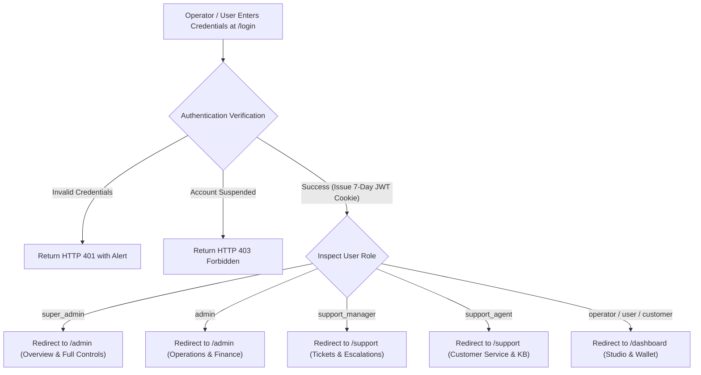

# Accero PrintPortal — Authentication, User Roles & Login Guide

This document provides a comprehensive operational guide to authentication, role-based access control (RBAC), login endpoints, and account provisioning across all supported roles in **Accero PrintPortal**.

---

## 1. Quick Reference: Login URLs & Landing Destinations

The application uses a **universal login portal**. All users, regardless of role (from standard operators to Super Administrators), authenticate at the same login entry point:

| Environment | Web Login URL | API Authentication Endpoint |
| :--- | :--- | :--- |
| **Production** | `https://printportal.accero.app/login` | `POST https://printportal.accero.app/api/auth/login` |
| **Local Development** | `http://localhost:3000/login` | `POST http://localhost:3000/api/auth/login` |

### Post-Login Automatic Role Redirects

Upon entering valid credentials, the system automatically inspects the authenticated role inside the signed JWT and redirects the user to their designated dashboard:



---

## 2. Supported Roles & Permission Matrix

Accero PrintPortal supports 6 distinct roles defined in [`src/models/User.ts`](file:///Users/faisal/Documents/GitHub/accero_pp/src/models/User.ts) and [`src/lib/rbac.ts`](file:///Users/faisal/Documents/GitHub/accero_pp/src/lib/rbac.ts):

| Role Identifier | Canonical Role | Landing URL | Allowed Route Prefixes | Primary Scope & Responsibilities |
| :--- | :--- | :--- | :--- | :--- |
| `super_admin` | Super Administrator | `/admin` | `/admin/*`, `/dashboard/*`, `/support/*`, `/studio/*`, `/wallet/*` | **Full Platform Authority**: Staff team provisioning, promoting Super Admins, financial adjustments over ₹10,000, high-risk system configurations. |
| `admin` | Platform Administrator | `/admin` | `/admin/*`, `/dashboard/*`, `/support/*`, `/studio/*`, `/wallet/*` | **Operational & Business Management**: Operator oversight, campaigns & promo codes, service pricing, payment auditing, manual UTR review, adjustments $\le$ ₹10,000. |
| `support_manager` | Support Manager | `/support` | `/support/*`, `/dashboard/*` | **Support Leadership**: Ticket triage, reassigning tickets to agents, priority escalations, reviewing operator support history, knowledge base curation. |
| `support_agent` | Support Agent | `/support` | `/support/*`, `/dashboard/*` | **Frontline Customer Support**: Answering tickets, guided card troubleshooting, inspecting masked operator logs (phone/email masked for citizen privacy). |
| `operator` | Print Operator | `/dashboard` | `/dashboard/*`, `/studio/*`, `/wallet/*`, `/cards/*` | **Document Printing Specialist**: High-volume card printing, Aadhaar/PAN/Voter/DL/RC smart card generation, wallet top-up, CR80 tray exports. |
| `user` / `customer` | Standard User | `/dashboard` | `/dashboard/*`, `/studio/*`, `/wallet/*`, `/cards/*` | **Self-Service Customer**: Default account registered via `/register`. Document verification, manual card builder, personal print downloads. |

---

## 3. How to Login as Each Role

### Universal Authentication Requirements
For **any role**, the login form accepts either:
1. **Email Address** (e.g., `superadmin@accero.app`)
2. **10-Digit Mobile Number** (e.g., `9876543201`)
3. **Password** (min. 8 characters, hashed using bcrypt)

---

### 3.1 Logging in as `super_admin` (Super Administrator)
* **Login URL:** [`/login`](http://localhost:3000/login)
* **Identifier:** Super Admin Email or registered 10-digit mobile number
* **Automatic Landing Page:** [`/admin`](http://localhost:3000/admin)
* **Unique Super Admin Features:**
  * Access to **Staff Team Management** at [`/admin/team`](http://localhost:3000/admin/team) to create or elevate other users to `super_admin`, `admin`, `support_manager`, or `support_agent`.
  * Exclusive authorization to execute manual wallet financial adjustments exceeding ₹10,000.
  * Audit log visibility over all administrative actions.

---

### 3.2 Logging in as `admin` (Platform Administrator)
* **Login URL:** [`/login`](http://localhost:3000/login)
* **Identifier:** Administrator Email or 10-digit mobile number
* **Automatic Landing Page:** [`/admin`](http://localhost:3000/admin)
* **Admin Features:**
  * **Operator Management:** [`/admin/operators`](http://localhost:3000/admin/operators) — review registered operators, inspect balances, suspend fraudulent accounts.
  * **Wallet & Finance:** [`/admin/finance`](http://localhost:3000/admin/finance) — approve/reject manual UPI UTR recharge submissions, execute adjustments up to ₹10,000.
  * **Campaigns & Bonuses:** [`/admin/campaigns`](http://localhost:3000/admin/campaigns) — manage recharge bonus campaigns.
  * **Promo Codes & Coupons:** [`/admin/promo-codes`](http://localhost:3000/admin/promo-codes) — create, edit, activate/deactivate, and audit coupon codes.
  * **Service Pricing:** [`/admin/services`](http://localhost:3000/admin/services) — update live per-document verification fees (PAN, Aadhaar, Voter, DL, RC).
  * **Payment Auditing:** [`/admin/payments`](http://localhost:3000/admin/payments) — verify Paytm gateway orders and settlement status.
  * **Reports & Exports:** [`/admin/reports`](http://localhost:3000/admin/reports) — export financial and transaction CSV reports.

---

### 3.3 Logging in as `support_manager` (Support Manager)
* **Login URL:** [`/login`](http://localhost:3000/login)
* **Identifier:** Support Manager Email or 10-digit mobile number
* **Automatic Landing Page:** [`/support`](http://localhost:3000/support)
* **Manager Capabilities:**
  * View open and escalated support tickets across the platform.
  * Assign tickets directly to specific support agents.
  * Escalate tickets requiring administrative attention.
  * Access operator troubleshooting profiles with privacy-masked citizen data.
  * Support managers **cannot** adjust user wallet balances (enforced by server guards).

---

### 3.4 Logging in as `support_agent` (Support Agent)
* **Login URL:** [`/login`](http://localhost:3000/login)
* **Identifier:** Support Agent Email or 10-digit mobile number
* **Automatic Landing Page:** [`/support`](http://localhost:3000/support)
* **Agent Capabilities:**
  * Resolve tickets assigned to them or unassigned in the queue.
  * Send replies and resolve technical card formatting issues.
  * Access the Knowledge Base at [`/support/knowledge-base`](http://localhost:3000/support/knowledge-base).
  * Customer email and phone details are automatically masked (`f***@domain.com`, `+91*****321`) to prevent data leakage.

---

### 3.5 Logging in as `operator` or `user` (Customer / Print Operator)
* **Login URL:** [`/login`](http://localhost:3000/login)
* **Identifier:** Operator Email or 10-digit mobile number
* **Automatic Landing Page:** [`/dashboard`](http://localhost:3000/dashboard)
* **Operator Capabilities:**
  * **Interactive Split-Screen Studio:** [`/studio`](http://localhost:3000/studio) — real-time data input, photo/signature upload, QR code generation.
  * **Print PVC Tray Engine:** Side-by-side or dual-slot ISO/IEC 7810 ID-1 card printing for Aadhaar, PAN, Voter ID, Driving License, and Vehicle RC.
  * **Wallet & Recharge:** [`/wallet`](http://localhost:3000/wallet) — dynamic Paytm UPI QR top-ups, promo code redemption, transaction receipts.
  * **Saved Cards Gallery:** [`/cards`](http://localhost:3000/cards) — free unlimited re-prints of previously generated cards.

---

## 4. How to Create & Provision Accounts for Each Role

There are **4 ways** to provision accounts depending on whether you are working in local development, staging, or production:

### Method 1: Automated Demo Seeding Script (Fastest for Local Dev)
A ready-to-run seeding script is included in the project:

```bash
npm run seed:users
```

This command connects to your MongoDB database (configured in `.env.local`) and automatically provisions or updates verified test accounts for all 6 roles with pre-set balances:

| Role | Email | Mobile | Default Password | Initial Balance | Redirect Destination |
| :--- | :--- | :--- | :--- | :--- | :--- |
| `super_admin` | `superadmin@accero.app` | `9876543201` | `SuperAdmin@123` | ₹5,000 | `/admin` |
| `admin` | `admin@accero.app` | `9876543202` | `Admin@123` | ₹2,500 | `/admin` |
| `support_manager` | `supportmgr@accero.app` | `9876543203` | `SupportMgr@123` | ₹500 | `/support` |
| `support_agent` | `supportagent@accero.app` | `9876543204` | `SupportAgent@123` | ₹200 | `/support` |
| `operator` | `operator@accero.app` | `9876543205` | `Operator@123` | ₹1,000 | `/dashboard` |
| `user` | `user@accero.app` | `9876543206` | `User@123` | ₹250 | `/dashboard` |

---

### Method 2: Self-Service Registration (For Operators & Users)
1. Navigate to [`/register`](http://localhost:3000/register).
2. Enter Name, Email, 10-digit mobile number, and password (min. 8 characters).
3. Click **"Create Operator Account"**.
4. The system provisions the user with role `user` (operator) and creates an initial wallet with ₹0 balance.
5. The operator is automatically logged in and redirected to `/dashboard`.

---

### Method 3: Via Super Admin Team Management (`/admin/team`)
Once a Super Admin account exists:
1. Log in as `super_admin` and navigate to [`/admin/team`](http://localhost:3000/admin/team).
2. Click **"+ Add Team Member"**.
3. Fill in:
   * **Full Name**
   * **Email Address**
   * **10-Digit Mobile**
   * **Temporary Password**
   * **Assigned Role**: Select from `Super Administrator`, `Platform Administrator`, `Support Manager`, or `Support Agent`.
4. Click **"Save Staff Member"**.
5. The staff member can immediately log in at `/login` with the assigned credentials.

> [!NOTE]
> Only users with the `super_admin` role can access `/admin/team` and create or promote other administrators. Standard `admin` accounts cannot modify team roles.

---

### Method 4: Direct MongoDB Shell / Compass Command (Bootstrapping First Admin)
If starting from an empty production database without any existing Super Admin:

1. Register an account via [`/register`](http://localhost:3000/register) using your preferred email (e.g. `owner@yourdomain.com`).
2. Open your MongoDB Shell (`mongosh`) or MongoDB Compass connected to your database.
3. Run the following command to elevate the user to `super_admin`:

```javascript
db.users.updateOne(
  { email: "owner@yourdomain.com" },
  { $set: { role: "super_admin", status: "active" } }
);
```

4. Log out and log back in at `/login`. You will now automatically land on the Super Admin console at `/admin`.

---

## 5. Security & Session Technical Details

### HTTP-Only Cookie Session
* Upon successful authentication, the server sets an `auth-token` cookie.
* **Flags:** `HttpOnly; SameSite=Lax; Path=/; Max-Age=604800` (7 days). In production, `Secure` is automatically appended.
* **Token Payload:** Contains `userId`, `email`, `name`, and normalized `role`.

### Route Boundary Enforcement (`src/middleware.ts`)
* **Unauthenticated Access:** Accessing protected routes (`/dashboard`, `/studio`, `/wallet`, `/admin`, `/support`, `/cards`) without a valid token redirects to `/login?redirect=<requested_url>`.
* **Admin Route Protection:** Accessing `/admin/*` requires `super_admin` or `admin`. Non-admin accounts attempting access are redirected to `/dashboard?error=unauthorized_admin`.
* **Support Route Protection:** Accessing `/support/*` requires `super_admin`, `admin`, `support_manager`, or `support_agent`. Unauthorized users are redirected to `/dashboard?error=unauthorized_support`.
* **Auth Page Bypass:** If an already-authenticated user visits `/login` or `/register`, middleware intercepts the request and instantly forwards them to their role-specific dashboard.
* **Open Redirect Defense:** The `getSafeRedirectUrl()` utility ensures query redirects must be relative paths starting with a single `/` and prevents redirection loops.

---

## 6. Programmatic Authentication API (`cURL` Example)

To authenticate via API or test tools:

```bash
curl -X POST https://printportal.accero.app/api/auth/login \
  -H "Content-Type: application/json" \
  -d '{
    "identifier": "admin@accero.app",
    "password": "Admin@123"
  }' \
  -c cookies.txt
```

### Successful Response:
```json
{
  "message": "Logged in successfully",
  "user": {
    "id": "672f0a1b8c4d2e0012345678",
    "name": "Platform Administrator",
    "email": "admin@accero.app",
    "phone": "9876543202",
    "role": "admin",
    "walletBalance": 2500
  },
  "redirectTo": "/admin"
}
```
The cookie `auth-token` stored in `cookies.txt` will authenticate subsequent requests.

