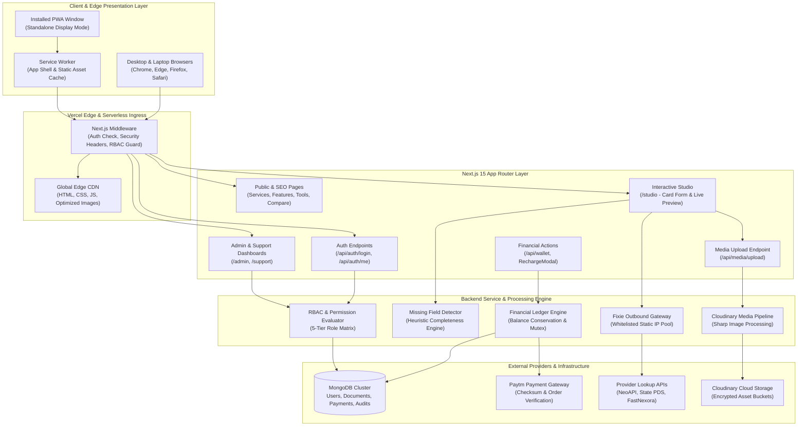

# Accero PrintPortal — System Architecture Overview

**Author:** Technical Documentation Architect & Engineering Review  
**Status:** Living Engineering Specification  
**Last Updated:** November 2026  
**Target Platform:** Next.js 15 (App Router) / React 19 / Vercel Serverless / MongoDB 8.x  

---

## 1. System Mission & Operational Scope

**Accero PrintPortal** (`https://printportal.accero.app`) is an independent, high-performance web platform engineered for CSC (Common Services Center) operators, cyber cafe proprietors, digital service centers, and document printing retailers across India.

The platform solves the critical operational challenge of document printing: external government lookup endpoints are frequently latent, down, or return incomplete records. Accero provides an interactive split-screen card canvas editor with automatic missing-field detection, allowing operators to verify, edit, and fill missing data before rendering pixel-perfect, physical-card-ready PVC documents without wasting expensive PVC blanks.

> [!IMPORTANT]
> **Statutory Disclaimer & Non-Affiliation:** Accero PrintPortal is an independent document layout, formatting, and management utility. It is not affiliated with, endorsed by, or sponsored by UIDAI, the Income Tax Department, the Election Commission of India, MoRTH, or any state government department.

---

## 2. Core Architectural Principles

1. **Zero Missing-Data Printing Failures:** External government lookup endpoints frequently return incomplete records. The system flags missing or low-confidence fields in real-time, allowing operators to manually edit, upload photos/signatures, and preview before deduction or printing.
2. **Financial Ledger Conservation:** Every balance mutation (top-up, card verification fee, re-print waiver) is executed atomically using MongoDB conditional updates (`$inc`, `$gte`) within strict ACID transactions. Balance can never drop below zero.
3. **Zero-Trust Client Security & DPDPA Privacy:** Identity documents contain Sensitive Personal Data (PII). Plaintext citizen records are protected in transit with TLS 1.3, cached with strict TTL expiration, and never cached inside public service worker caches.
4. **Physical Standard Precision (CR80 ID-1):** Output canvases conform exactly to the ISO/IEC 7810 ID-1 standard ($85.60\text{ mm} \times 53.98\text{ mm}$ at 300+ DPI), guaranteeing alignment in dual-card PVC printer trays.
5. **High-Availability Edge & Serverless Architecture:** Hosted on Vercel Serverless Functions with static pre-rendering, Edge metadata routing, and connection-pooled MongoDB database access.

---

## 3. Technology Stack & Runtime Topology

| Layer | Technology | Version | Purpose |
| :--- | :--- | :--- | :--- |
| **Framework** | Next.js (App Router) | `15.1.x` / `15.5.x` | Server Components, Route Handlers, Server Actions, Dynamic Metadata |
| **Frontend Runtime** | React | `19.0.0` | Declarative UI, Concurrent Rendering, Optimistic UI updates |
| **Language** | TypeScript | `5.7.3` | Strict type safety across document schemas, financial ledgers, and API responses |
| **Styling** | Tailwind CSS | `3.4.17` | Utility-first design system with custom brand tokens (`brand-navy`, `accent-amber`, `crimson`) |
| **Database** | MongoDB | `8.x` / Mongoose `9.10.x` | Persistent storage, document versioning, user sessions, audit logs, and ledger events |
| **Media Pipeline** | Cloudinary & Sharp | Sharp `0.35.x` / SDK `2.11.x` | Server-side image optimization, background removal, photo cropping, and secure signed delivery |
| **Outbound Proxy** | Fixie Socks5 / HTTP Proxy | `https-proxy-agent` `9.1.x` | Static outbound IP routing for whitelisted government data provider APIs |
| **Authentication** | `jose` JWT & bcryptjs | `jose` `6.2.x` / `bcryptjs` `3.0.x` | Cryptographic session tokens, HTTP-only cookie guards, and 5-tier RBAC |
| **Payments** | Paytm Payment Gateway | Custom Node integration | Checksum-verified UPI, NetBanking, and Wallet recharge order flows |
| **Document Export** | jsPDF & html2canvas | `jspdf` `4.2.x` / `html2canvas` `1.4.x` | Client-side vector and raster PDF generation matching CR80 card trays |
| **Rate Limiting** | Upstash Redis & MongoDB | `@upstash/ratelimit` `2.2.x` | Sliding-window IP and token-based abuse prevention on public and API routes |
| **Deployment** | Vercel Platform | Serverless / Edge Runtime | Edge caching, automated CI/CD builds, and global CDN delivery |

---

## 4. System Architecture Diagram



---

## 5. Architectural Subsystems

### 5.1 Presentation & Interactive Studio Layer
- **Live Canvas Architecture:** Dual-sided (Front/Back) rendering coordinates with SVG backgrounds, vector barcode generation (`jsbarcode`), and high-density 2D QR codes (`qrcode`).
- **Interactive Split-Screen:** Left-side structured forms with real-time field bindings; right-side live canvas rendering with instant visual feedback.
- **Multilingual Script Support:** Integrated Google Fonts (`Hind`, `Roboto`, `Open Sans`) supporting Hindi, Gujarati, Bengali, Marathi, Telugu, Tamil, Kannada, Punjabi, and Urdu Devanagari/regional typography.

### 5.2 Verification & Outbound Ingress Layer
- **Outbound IP Routing:** Critical government providers enforce strict IP whitelisting. External requests to NeoAPI, FastNexora, and provider endpoints are routed through Fixie static proxies (`https-proxy-agent`) to guarantee constant ingress IPs.
- **Circuit Breakers & Retries:** Synchronous lookup requests implement 8000ms timeouts with automatic fallback chains (e.g. NeoAPI V1 $\rightarrow$ V2 fallback).
- **Document Record Retention:** Documents verified via paid lookups are stored in `DocumentRecord` with 72-hour free re-printing windows, preventing redundant charges for the same citizen record.

### 5.3 Financial Ledger & Payment Engine
- **Atomic Operations:** All wallet transactions employ `$inc` operations with `$gte` guards:
  $$\text{NewBalance} = \text{OldBalance} - \text{Fee} \quad (\text{subject to } \text{OldBalance} \ge \text{Fee})$$
- **Paytm Order Lifecycle:** Server-side checksum generation with SHA256; webhook verification with automated retry reconciliation.
- **Tamper-Proof Audit Chain:** All deductions generate immutable `AuditLog` entries storing operator ID, document type, masked reference number, fee charged, and pre/post balance snapshots.

### 5.4 Progressive Web App (PWA) Layer
- **Native OS Feel:** Configured via `manifest.webmanifest` for standalone application execution on Windows 11, macOS, Android, and iOS/iPadOS.
- **Zero-Trust Service Worker (`public/sw.js`):** Never caches private document endpoints, auth tokens, or wallet state. Implements cache-first policies for static assets and offline navigation fallbacks.

### 5.5 Media Storage & Optimization
- **Dual-Storage Engine:** Temporary client-side Base64 preview buffers backed by permanent Cloudinary cloud storage via Sharp transformations.
- **Background Erasure & Masking:** High-resolution citizen portraits are scaled, formatted, and optimized for physical card contrast standards before PDF composition.

---

## 6. Directory Structure Overview

```
accero_pp/
├── src/
│   ├── actions/          # Next.js Server Actions (wallet, verify, print, admin, promo)
│   ├── app/              # Next.js App Router (Routes, API endpoints, layouts)
│   ├── components/       # Modular UI components (cards, studio, layout, wallet, pwa)
│   ├── hooks/            # Custom React hooks (usePwaInstall, useDebounce, etc.)
│   ├── lib/              # Core business logic (auth, mongodb, payment, rbac, seo)
│   ├── models/           # Mongoose Data Models (User, DocumentRecord, Wallet, etc.)
│   └── types/            # TypeScript interfaces & domain declarations
├── docs/                 # Authoritative documentation architecture
│   ├── architecture/     # Core system architecture, database, financial models
│   ├── security/         # Security audits, RBAC matrices, authentication guides
│   ├── operations/       # Operational runbooks (admin, support, GSC, GA4)
│   ├── document-templates/# ISO CR80 standards, ration card, printing guides
│   ├── design/           # Design system tokens and public route UI audits
│   ├── pwa/              # PWA architecture, service worker, testing reports
│   ├── cloudinary/       # Media pipeline, image processing, verification reports
│   ├── seo/              # Living SEO/GEO/AEO strategies, entity data, keywords
│   │   ├── competitor-intelligence/  # Market audits, competitor profiles, gap analyses
│   │   └── ration-farmer/            # Specialized rural document acquisition strategy
│   └── reports/          # Historical release audits, checklists, and test matrices
│       ├── phase2/       # Phase 2 milestone reports & verification audits
│       ├── phase3/       # Phase 3/3.1/3.1.2 release gates & defect matrices
│       └── artifacts/    # Historical benchmark artifacts, PDF specs, and HTML audits
├── public/               # Static assets, icons, manifest, service worker
└── tests/                # Automated Vitest test suites (32 test suites, 323+ tests)
```

---

## 7. Related Authoritative Documentation

- [Database Migration & Index Strategy](file:///Users/faisal/Documents/GitHub/accero_pp/docs/architecture/database-migration.md)
- [Financial Integrity & Ledger Conservation](file:///Users/faisal/Documents/GitHub/accero_pp/docs/architecture/financial-integrity.md)
- [Production Readiness & Milestone Verification](file:///Users/faisal/Documents/GitHub/accero_pp/docs/architecture/production-readiness.md)
- [Security Architecture & Threat Model](file:///Users/faisal/Documents/GitHub/accero_pp/docs/security/security-audit.md)
- [RBAC Permission Matrix & Access Boundary](file:///Users/faisal/Documents/GitHub/accero_pp/docs/security/rbac-matrix.md)
- [PWA Architecture Specification](file:///Users/faisal/Documents/GitHub/accero_pp/docs/pwa/architecture.md)
- [Cloudinary Media Architecture](file:///Users/faisal/Documents/GitHub/accero_pp/docs/cloudinary/architecture.md)
