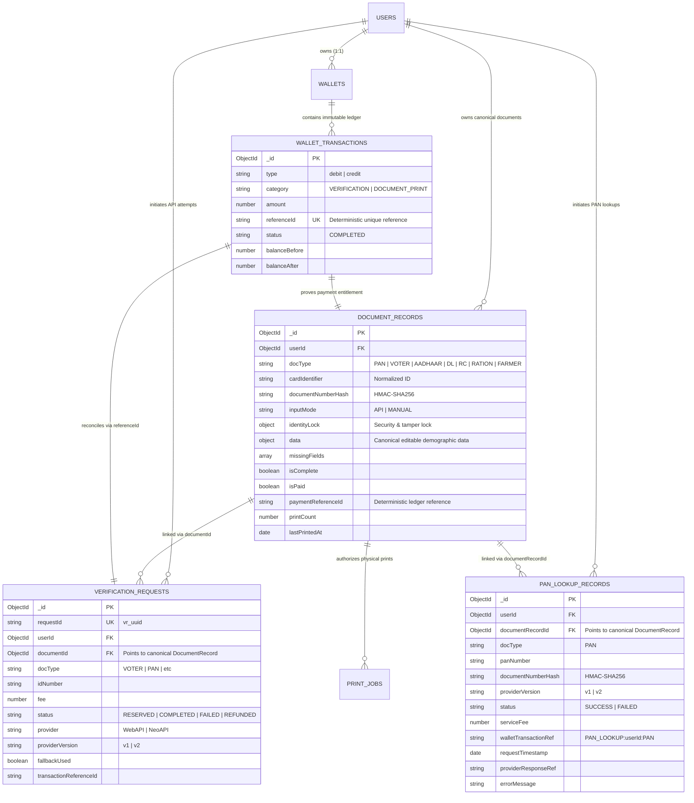

# Document and Lookup Data Architecture

**Accero PrintPortal MongoDB Architecture Specification**  
**Role:** Senior MongoDB Architect, Mongoose Engineer, Financial Integrity Auditor  
**Database:** MongoDB Atlas (`accero_pp`)  
**Status:** Approved Architecture Standard

---

## 1. Executive Summary & Problem Analysis

In Accero PrintPortal, document processing workflows revolve around two primary operations:
1. **Verification & Lookup**: Querying third-party government gateways (e.g. WebAPI for PAN, NeoAPI for Voter) to retrieve verified demographic data and debiting a lookup fee from the operator's wallet.
2. **Editing & Card Production**: Allowing the cyber cafe or CSC operator to adjust layouts, fill missing fields, upload high-resolution photographs/signatures, and print ISO/IEC 7810 CR80 PVC cards.

A separate collection named `panlookuprecords` was initially created alongside the canonical `documentrecords` collection. This architecture investigation evaluated whether `panlookuprecords` is architecturally justified, identified overlapping demographic fields, resolved the absence of foreign key references, and established `documentrecords` as the **sole authoritative canonical source of truth**.

---

## 2. Collection Responsibilities & Source of Truth

| Architectural Dimension | `documentrecords` (Canonical Source of Truth) | `panlookuprecords` & `verificationrequests` (Audit & History) |
| :--- | :--- | :--- |
| **Primary Responsibility** | Editable, printable, customer-facing card state. | Operational API attempt log, gateway diagnostics, audit history. |
| **Data Mutability** | **Mutable**: Operators can edit fields (typos, house numbers, photo, signature). | **Immutable**: Read-only historical snapshot of raw gateway response. |
| **Authorization Role** | **Authoritative**: Required for PDF rendering, CR80 tray printing, and layout preview. | **Non-authoritative**: NEVER directly authorizes printing or free reprints. |
| **Financial Role** | Carries `isPaid: true`, `paymentReferenceId`, and `identityLock`. | Records `fee`, `walletTransactionRef`, and gateway attempt reference. |
| **Retention Policy** | Persistent (user-owned document asset). | Audit trail retention policy (append-only log). |
| **Field Scope** | Complete document model (data, missingFields, images, metadata). | Lightweight metadata (status, version, error, timestamps). |

### Strict Invariant: Single Source of Truth
`documentrecords` is the **only collection** consulted when rendering, editing, or printing a card. `panlookuprecords` exists strictly as an operational history and gateway audit trail.

---

## 3. Entity Relationship Architecture



---

## 4. Why `panlookuprecords` Exists & Architectural Recommendation

### Origin
`panlookuprecords` was created during the initial implementation of the dedicated PAN Lookup gateway to satisfy dashboard history requirements (`/dashboard/pan-lookup`) showing past verification queries.

### Redundancy & Shortcomings Identified
1. **Duplicate Demographic Data**: Stored raw `fullName`, `fatherName`, `dateOfBirth`, and `gender`, creating two conflicting answers if the operator edited `DocumentRecord`.
2. **Missing Relationship**: Did not contain `documentRecordId`, breaking relational tracing between the lookup event and the resulting document.
3. **Redundant with `VerificationRequest`**: `VerificationRequest` was already designed as an abstraction over verification attempts across all document types.

### Architectural Decision & Recommendation
* **Rule**: In accordance with system stability constraints, `panlookuprecords` is **retained for backward compatibility** to preserve existing dashboard history endpoints without breaking client contracts.
* **Normalization**: `panlookuprecords` has been enhanced with:
  - `documentRecordId` (pointing to `DocumentRecord._id`).
  - `docType: 'PAN'`.
  - `documentNumberHash` (HMAC-SHA256).
* **Write Order**: `DocumentRecord` is written **first** via `saveDocumentToCache()`, and the resulting `_id` is passed down to `panlookuprecords` and `verificationrequests`.
* **Future Consolidation**: All document types (Voter, PAN, Aadhaar, DL, RC) should converge on `VerificationRequest` as the unified audit collection with a polymorphic `docType` discriminator.

---

## 5. Unified Verification Model Across All 7 Document Types

| Document Type | Primary Provider | Fallback Provider | Canonical Collection | Unified Audit Collection |
| :--- | :--- | :--- | :--- | :--- |
| **PAN** | WebAPI V1 | WebAPI V2 | `documentrecords` | `verificationrequests` + `panlookuprecords` (compat) |
| **VOTER** | NeoAPI V1 | NeoAPI V2 | `documentrecords` | `verificationrequests` |
| **AADHAAR** | Direct / OCR | Manual Entry | `documentrecords` | `verificationrequests` |
| **DRIVING LICENCE** | NeoAPI / Parivahan | Manual Entry | `documentrecords` | `verificationrequests` |
| **VEHICLE RC** | NeoAPI / Vahan | Manual Entry | `documentrecords` | `verificationrequests` |
| **RATION CARD** | State PDS / NFSA | Manual Entry | `documentrecords` | `verificationrequests` |
| **FARMER ID** | AgriStack | Manual Entry | `documentrecords` | `verificationrequests` |

---

## 6. Indexing & Tenant Isolation Strategy

### `documentrecords` Indexes
```javascript
// Tenant-scoped lookups
DocumentRecordSchema.index({ userId: 1, docType: 1, cardIdentifier: 1 });
DocumentRecordSchema.index({ userId: 1, docType: 1, documentNumberHash: 1 });
DocumentRecordSchema.index({ userId: 1, expiresAt: 1 });

// Automatic 72-hour TTL cache expiration
DocumentRecordSchema.index({ expiresAt: 1 }, { expireAfterSeconds: 0 });
```

### `panlookuprecords` Indexes
```javascript
// History listing & deduplication
PanLookupRecordSchema.index({ userId: 1, panNumber: 1, createdAt: -1 });

// Foreign key relational lookups
PanLookupRecordSchema.index({ userId: 1, documentRecordId: 1 });
PanLookupRecordSchema.index({ documentRecordId: 1 });
PanLookupRecordSchema.index({ documentNumberHash: 1 });
```

---

## 7. Data Privacy & Least-Privilege Architecture

1. **Deterministic Hashing**: Document identity numbers are hashed using HMAC-SHA256 (`normalizedType:normalizedId`) with `JWT_SECRET` salt, allowing fast index lookups without exposing plaintext credentials.
2. **Audit Immutability**: Historical lookup records are strictly append-only. When an operator updates customer details, edits are applied to `DocumentRecord`, leaving the original gateway audit trail intact.
3. **No Unencrypted Secondary PII**: Future schema updates should deprecate storing raw names and father names inside secondary audit logs, referencing `documentRecordId` instead.
