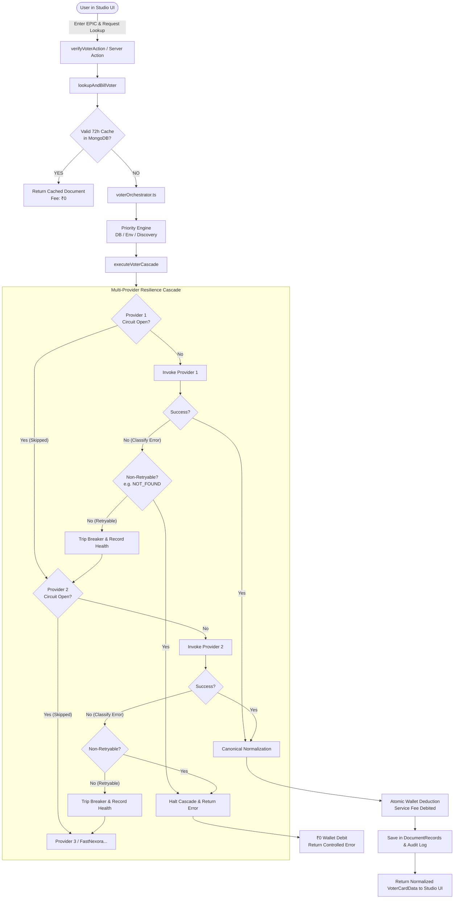
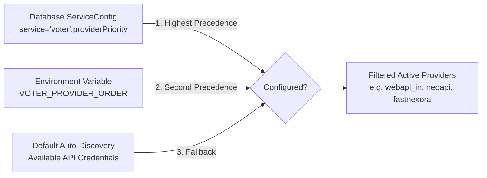

# Voter Provider Multi-Adapter Architecture

## 1. System Overview

Accero PrintPortal provides high-reliability document verification and physical PVC card printing. For Voter ID (EPIC) lookups, relying on a single external upstream provider creates a single point of failure (SPOF) due to frequent upstream rate limiting, downtime, network instability, or portal maintenance.

To guarantee continuous availability and sub-second response times, PrintPortal implements an **extensible, multi-provider cascading architecture** featuring:
- An **Adapter Pattern** isolating provider-specific HTTP protocols, auth schemes, and schemas.
- A **Dynamic Priority Engine** resolving provider execution order via database configuration (`ServiceConfig.providerPriority`) or environment variables (`VOTER_PROVIDER_ORDER`).
- A **Resilience Layer** combining an intelligent Error Classifier, Circuit Breaker state machine, and rolling Health Tracker.
- A **Unified Normalization Layer** transforming heterogeneous upstream payloads into the canonical `VoterCardData` domain model.
- An **Idempotent Billing Boundary** ensuring wallet deduction occurs strictly once per new verified lookup and never on failures or cached reprints.



---

## 2. Core Components

### 2.1 Provider Adapter Interface (`IVerifyProvider`)
All voter verification providers conform to `IVerifyProvider` defined in `src/lib/verify/types.ts`:

```typescript
export interface IVerifyProvider {
  readonly id: string;
  readonly name: string;
  readonly supportedDocTypes: DocumentType[];

  lookup(
    docType: DocumentType,
    identifier: string,
    options?: Record<string, unknown>
  ): Promise<ProviderLookupResult>;

  getCaptcha?(
    options?: Record<string, unknown>
  ): Promise<ProviderCaptchaResult>;

  lookupWithCaptcha?(
    docType: DocumentType,
    identifier: string,
    captchaData: ProviderCaptchaInput,
    options?: Record<string, unknown>
  ): Promise<ProviderLookupResult>;

  healthCheck?(): Promise<ProviderHealthCheckResult>;
}
```

#### Registered Voter Providers
1. **`NeoApiProvider` (`neoapi`)**: Primary enterprise API with dual-version failover (`v1/voter/detail.php` -> fallback `v2/voter/detail.php`).
2. **`WebApiInProvider` (`webapi_in`)**: High-speed direct voter endpoint (`voter_details.php`) plus interactive Captcha bypass capabilities (`voter_captcha.php` & `voter_captcha_info.php`).
3. **`FastNexoraProvider` (`fastnexora`)**: Legacy fallback provider for backward compatibility.

---

## 3. Dynamic Priority Resolution

The execution order of providers is resolved dynamically at runtime by `getPrioritizedVoterProviders()` in `src/lib/verify/voterOrchestrator.ts`:



1. **Database ServiceConfig (`ServiceConfig.providerPriority`)**:
   Admin users can drag-and-drop or use up/down reorder arrows in the Admin Dashboard (`/admin/services`) to change priority without redeploying code.
2. **Environment Variable (`VOTER_PROVIDER_ORDER`)**:
   Comma-separated string (e.g. `webapi_in,neoapi,fastnexora`) set in Vercel or local `.env`.
3. **Automatic Discovery (`getAvailableVoterProviders`)**:
   Inspects server environment variables (`WEBAPI_IN_TOKEN`, `NEO_API_KEY`, `FASTNEXORA_API_KEY`) and activates configured providers in standard default order.

---

## 4. Cascading Execution & Failover Policy

The cascade function `executeVoterCascade` executes providers sequentially according to the resolved priority:

### Short-Circuiting & Circuit Breakers
Before invoking any provider:
1. The provider's circuit state is checked via `circuitBreaker.canExecute(providerId)`.
2. If `OPEN`, the provider is skipped immediately, saving upstream latency.
3. If `HALF_OPEN`, a single trial request is permitted to test provider recovery.

### Intelligent Error Evaluation
When an invocation completes:
- **On Success**: Circuit breaker records success (resetting failure count or closing half-open circuits), latency is recorded in rolling P50/P95 metrics, and normalized data is returned immediately.
- **On Failure**: The error is classified by `classifyProviderError(result)`:
  - **Non-Retryable Errors** (`INVALID_EPIC`, `NOT_FOUND`, `CAPTCHA_INVALID`, `CAPTCHA_EXPIRED`, `UNAUTHORIZED`, `INSUFFICIENT_BALANCE`):
    The cascade **halts immediately**. If an EPIC does not exist in the electoral roll or the user typed an invalid number, querying downstream providers is wasteful and will produce identical negative results.
  - **Retryable Errors** (`TIMEOUT`, `RATE_LIMITED`, `AUTH_ERROR`, `INFRASTRUCTURE_ERROR`, `MALFORMED_RESPONSE`, `PROVIDER_ERROR`):
    The circuit breaker records a failure (tripping to `OPEN` after 3 consecutive failures). The cascade continues to the next available provider.

---

## 5. Adding a New Voter Provider (Developer Guide)

Adding a new provider requires zero modification to existing business logic or UI code:

1. **Register the Provider in `src/lib/network/provider-registry.ts`**:
   Add the provider ID, target origin, timeout, and routing configuration (Direct vs Fixie static proxy):
   ```typescript
   export const PROVIDER_REGISTRY: Record<string, ProviderConfig> = {
     // ...
     new_voter_api: {
       id: 'new_voter_api',
       baseUrl: 'https://api.newvoterprovider.com/v1',
       timeoutMs: 15_000,
       retryCount: 1,
       routing: 'direct', // or 'fixie' if IP whitelisting is required
     },
   };
   ```

2. **Implement the Provider Adapter in `src/lib/verify/providers/newVoterApi.ts`**:
   Implement `IVerifyProvider`, wrap requests using `providerFetch`, handle validation, and integrate with health tracking:
   ```typescript
   export class NewVoterApiProvider implements IVerifyProvider {
     readonly id = 'new_voter_api';
     readonly name = 'New Voter Provider';
     readonly supportedDocTypes: DocumentType[] = ['voter'];

     async lookup(docType: DocumentType, identifier: string): Promise<ProviderLookupResult> {
       // Validate input, fetch data via providerFetch, normalize, return ProviderLookupResult
     }
   }
   ```

3. **Register in `src/lib/verify/voterOrchestrator.ts`**:
   Add provider instantiation to `createVoterProviderInstance(id)` and discovery checks to `getAvailableVoterProviders()`.

4. **Update Priority Configuration**:
   Add `new_voter_api` to `VOTER_PROVIDER_ORDER` or configure via `/admin/services`.
