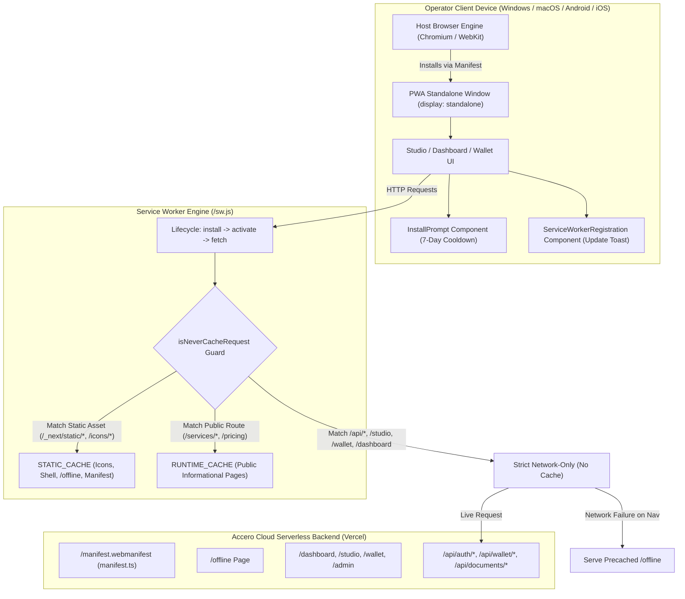

# Accero PrintPortal — PWA Architecture Specification

**Version:** 1.0.0  
**Target Platform:** Cross-Platform Progressive Web App (Windows 10/11, macOS, Android, iOS/iPadOS)  
**Host Application:** Next.js 15.5.26 (App Router), React 19, TypeScript Strict, Tailwind CSS  
**Target Audience:** CSC VLEs, Cyber Cafe Operators, Digital Service Centers, Printing Retailers  

---

## 1. Executive Summary & Design Vision

Accero PrintPortal operates as a high-reliability, mission-critical document processing and printing utility. In commercial CSC and cyber cafe environments across India, operators face variable network connectivity, frequent morning footfall spikes, and demanding physical printing requirements (Epson L805 PVC tray printing, thermal card printers, high-DPI PDF generation).

The Progressive Web App (PWA) architecture transforms Accero PrintPortal into an **installable desktop and mobile business application** from a single, shared Next.js codebase. Operators can launch Accero directly from their Windows taskbar, macOS Dock, Android home screen, or iOS app library into a distraction-free, dedicated standalone window without URL bars or browser chrome.

```
PWA Architecture Core Principles:
├── Zero Runtime Dependencies: Pure Web Standards (manifest.ts, sw.js, Cache API)
├── Strict Financial & Data Isolation: Zero caching of sensitive citizen PII, API tokens, or wallet ledgers
├── Deterministic Offline Guard: Dedicated /offline route gracefully pausing online operations
├── Non-Intrusive Installation: Platform-aware prompts with 7-day cooldown and iOS Safari walkthroughs
└── High-Precision Printing Preservation: 100% fidelity for ISO/IEC 7810 ID-1 (CR80) cards and 300+ DPI PDFs
```

---

## 2. High-Level PWA Architecture & Component Flow



---

## 3. Web App Manifest Specification (`src/app/manifest.ts`)

The manifest is generated dynamically via Next.js App Router metadata conventions (`MetadataRoute.Manifest`) and served with the standard `application/manifest+json` MIME type at `/manifest.webmanifest`.

### Configuration Attributes
| Property | Value | Rationale |
| :--- | :--- | :--- |
| `id` | `/` | Stable application identifier preventing duplicate desktop or mobile installs. |
| `name` | `Accero PrintPortal` | Official full application name displayed in app store surfaces and title bars. |
| `short_name` | `Accero` | Compact launcher label for Android and iOS home screen icons (under 12 chars). |
| `description` | `Document processing and printing platform...` | Clear, non-governmental utility descriptor. |
| `start_url` | `/` | Canonical entry point for launched standalone sessions. |
| `scope` | `/` | Authoritative routing boundary; external links open in default system browser. |
| `display` | `standalone` | Eliminates URL search bar, back/forward buttons, and tab strips, providing native window chrome. |
| `orientation` | `any` | Supports desktop monitors, vertical tablet stands, and mobile portrait/landscape orientations. |
| `background_color` | `#ffffff` | Clean white splash-screen background matching application cards. |
| `theme_color` | `#8B1E2D` | Imperial Burgundy brand accent applied to Android status bar and Windows title bar. |
| `categories` | `["business", "productivity", "utilities"]` | App store and browser classification tags. |

### Icon Declarations
The manifest exposes four primary icon assets:
1. `192x192` PNG (`purpose: "any"`) for taskbars, system notification drawers, and desktop shortcuts.
2. `512x512` PNG (`purpose: "any"`) for high-DPI desktop splash screens and Windows app tiles.
3. `192x192` Maskable PNG (`purpose: "maskable"`) with 20% safe-zone margin on solid white background for Android adaptive squircles and circles.
4. `512x512` Maskable PNG (`purpose: "maskable"`) for high-resolution Android launcher icons.

### Application Shortcuts
Enables instant access via right-click (Windows/macOS) or long-press (Android):
- **Document Studio:** Direct navigation to `/studio`.
- **Operator Dashboard:** Direct navigation to `/dashboard`.
- **Wallet & Ledger:** Direct navigation to `/wallet`.

---

## 4. Tiered Service Worker Caching Architecture (`public/sw.js`)

The service worker implements four distinct, non-overlapping caching policies:

```
Request Traversal Hierarchy:
┌────────────────────────────────────────────────────────┐
│ 1. Non-GET or Cross-Origin (non-font)                   │ ──> Passthrough to Network
└────────────────────────────────────────────────────────┘
                           │
┌────────────────────────────────────────────────────────┐
│ 2. isNeverCacheRequest (API, Auth, Wallet, Studio)     │ ──> NETWORK-ONLY (Never Cached)
└────────────────────────────────────────────────────────┘
                           │
┌────────────────────────────────────────────────────────┐
│ 3. Static Bundles (/_next/static/*, /icons/*, fonts)    │ ──> CACHE-FIRST (Fast Shell)
└────────────────────────────────────────────────────────┘
                           │
┌────────────────────────────────────────────────────────┐
│ 4. Public Navigation & Informational Pages             │ ──> NETWORK-FIRST -> Offline Page
└────────────────────────────────────────────────────────┘
```

---

## 5. Offline Fallback Mechanics

When an operator loses internet connectivity:
1. **Public Marketing & Documentation Pages:** If previously visited, served seamlessly from `RUNTIME_CACHE`. If unvisited, service worker returns the precached `/offline` page.
2. **Authenticated Operator Routes (`/studio`, `/dashboard`, `/wallet`, `/cards`):** The service worker deliberately refuses to serve stale cached state. When network fetch fails on a navigation request, it serves `/offline`.
3. **API Endpoints (`/api/*`):** Return HTTP 503 with JSON payload `{ error: "Network unavailable. Reconnect to proceed." }`.
4. **Offline User Experience (`src/app/offline/page.tsx`):** Displays real-time connection status pill (`navigator.onLine` listener), explains that financial and lookup transactions are safely paused, and provides a one-click "Retry Connection" action.

---

## 6. Push Notification Architecture (Roadmap)

In accordance with architectural guidelines, **push notifications are not faked or half-implemented**. Because the production backend currently lacks an encrypted VAPID key pair exchange, PushSubscription database collection, and Web Push queuing worker, push notifications are planned as a dedicated Phase 2 enhancement:

```
Push Notification Infrastructure Blueprint (Phase 2):
1. VAPID Key Generation: ECC P-256 key pair (VAPID_PUBLIC_KEY, VAPID_PRIVATE_KEY).
2. Database Schema: PushSubscription collection in MongoDB (userId, endpoint, p256dh, auth, deviceType).
3. Explicit User Opt-In: Contextual prompt triggered only AFTER successful wallet recharge or document print.
4. Serverless Worker: web-push Node.js payload dispatcher triggered by wallet credit events or support updates.
5. Strict Payload Sanitization: Notification payloads contain ONLY generic event alerts (e.g. "Recharge Successful - ₹500 added"), NEVER citizen identity details.
```

---

## 7. Versioning, Lifecycle & Update Management

1. **Deterministic Cache Busting:** Cache keys are tied to `CACHE_VERSION = 'accero-pwa-v1.0.0'`.
2. **Safe Background Updates:** The service worker updates in the background. The `ServiceWorkerRegistration` component listens for `updatefound` and `statechange` events.
3. **Non-Disruptive Notification:** When a new service worker enters the `waiting` state, a floating update banner surfaces with "Update Now". It **never forces an instant reload** while an operator may be actively editing a card or completing a payment.
4. **Atomic Activation:** Clicking "Update Now" posts `{ type: 'SKIP_WAITING' }`, triggering immediate cache cleanup and a clean page reload.
