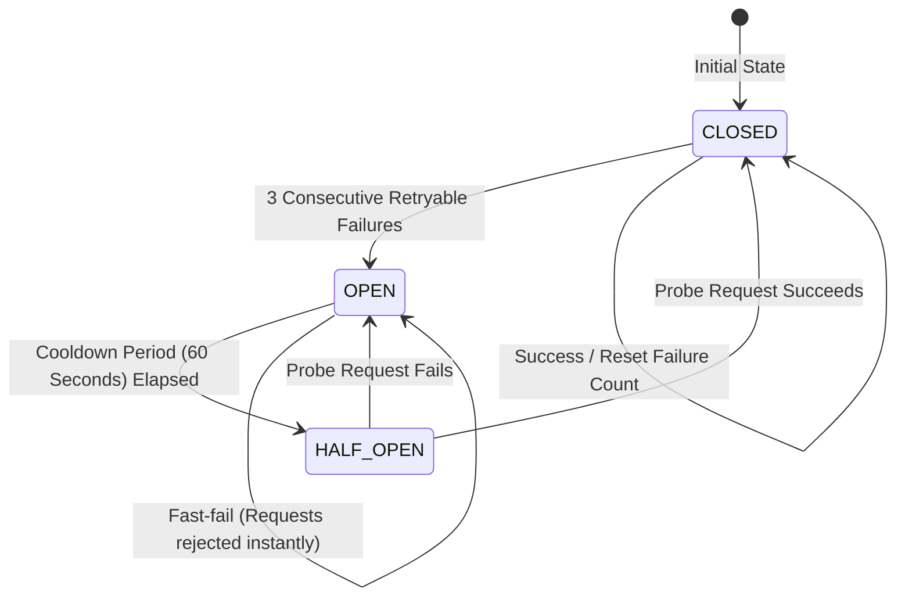

# Voter API Failover & Reliability Specification

## 1. Resilience Architecture Overview

Upstream government verification services and third-party API aggregators experience frequent latency spikes, upstream gateway timeouts (504), rate limit throttling (429), and intermittent maintenance outages.

Accero PrintPortal employs an enterprise reliability framework composed of three foundational patterns:
1. **Deterministic Error Classification**: Discerning between temporary provider infrastructure failures (which should cascade) and permanent business rejections (which should halt immediately).
2. **Circuit Breaker State Machine**: Preventing cascading failures and eliminating latency overhead by pausing calls to failing upstream providers.
3. **Rolling Health Telemetry**: Measuring real-time success rates, total throughput, timeouts, and latency percentiles (P50 and P95) per provider.

---

## 2. Error Classification Taxonomy

All provider failures are mapped to normalized error objects and evaluated by `classifyProviderError()` in `src/lib/reliability/errorClassifier.ts`.

### Classification Matrix

| Error Code | HTTP Status | Retryable? | Behavior | Trigger Conditions |
|---|---|---|---|---|
| `NOT_FOUND` | 404 / 200 | **NO** | **Halt Cascade Immediately** | Upstream explicitly indicates EPIC is not found in electoral rolls. Querying other providers would produce identical negative results. |
| `INVALID_EPIC` | 400 | **NO** | **Halt Cascade Immediately** | Input EPIC format fails validation (e.g. invalid length or illegal characters). |
| `CAPTCHA_INVALID` | 200 / 400 | **NO** | **Halt Cascade Immediately** | Captcha solution was entered incorrectly by the user. User must retry with fresh captcha. |
| `CAPTCHA_EXPIRED` | 200 / 400 | **NO** | **Halt Cascade Immediately** | Captcha session expired upstream (> 120s). Prompt user for fresh challenge. |
| `UNAUTHORIZED` | 401 | **NO** | **Halt Cascade Immediately** | Invalid API credentials. Halts to prevent account suspension. |
| `INSUFFICIENT_BALANCE` | 402 | **NO** | **Halt Cascade Immediately** | Tenant user wallet has insufficient funds to pay service fee. |
| `TIMEOUT` | 408 / 504 | **YES** | **Cascade to Next Provider** | Upstream request exceeded timeout limit (15,000ms). |
| `RATE_LIMITED` | 429 | **YES** | **Cascade to Next Provider** | Upstream quota exhausted or throttled. |
| `INFRASTRUCTURE_ERROR`| 500, 502, 503 | **YES** | **Cascade to Next Provider** | Upstream internal server error or gateway failure. |
| `MALFORMED_RESPONSE` | 200 | **YES** | **Cascade to Next Provider** | Upstream returned invalid JSON or HTML error page. |
| `PROVIDER_ERROR` | Any | **YES** | **Cascade to Next Provider** | Generic provider error with `status: false`. |

---

## 3. Circuit Breaker Specification (`circuitBreaker.ts`)

Each provider maintains an isolated state machine instance managed by `CircuitBreakerManager`:

### State Configuration
- **Failure Threshold**: `3` consecutive retryable errors.
- **Cooldown Window**: `60,000 ms` (60 seconds).
- **States**:
  - `CLOSED`: Normal operation. All requests pass through to the provider.
  - `OPEN`: Failure threshold exceeded. Requests skip this provider immediately and cascade to the next healthy provider, saving 15 seconds of timeout latency.
  - `HALF_OPEN`: Cooldown period expired. A single probe request is allowed. If it succeeds, the breaker resets to `CLOSED`. If it fails, the breaker trips back to `OPEN` for another 60 seconds.

### Admin Manual Override
Admins can manually trip or reset any circuit breaker via the Admin Portal (`/admin/services`) or server action `resetAdminCircuitBreaker(providerId)`.

---

## 4. Provider Health Telemetry (`providerHealth.ts`)

The `ProviderHealthTracker` records performance metrics for every outbound provider request:

### Tracked Metrics
- **Total Requests**: Cumulative count of dispatched requests.
- **Success Count & Rate**: Percentage of requests returning valid citizen data.
- **Failure Count**: Count of retryable and non-retryable errors.
- **Timeout Count**: Specific counter for requests that exceeded network deadlines.
- **Latencies (P50 & P95)**:
  - Calculated over a rolling sliding window of the last 100 requests.
  - Sorted array percentile extraction:
    $$\text{P50} = \text{sorted}[ \lfloor n \times 0.50 \rfloor ]$$
    $$\text{P95} = \text{sorted}[ \lfloor n \times 0.95 \rfloor ]$$
- **Circuit Breaker Status**: Current state (`CLOSED`, `OPEN`, `HALF_OPEN`) and consecutive failure counter.

---

## 5. Dynamic Priority Management & Admin Controls

Admins manage provider failover from `/admin/services` through:
1. **Interactive Priority Reordering**:
   - Up and Down controls to change priority order (e.g. promote `webapi_in` ahead of `neoapi`).
   - Click "Save Priority" to atomically update `ServiceConfig.providerPriority` in MongoDB.
2. **Live Health & Telemetry Cards**:
   - Visual health badges (`CLOSED` in green, `OPEN` in red, `HALF_OPEN` in amber).
   - Real-time success rate, P50, and P95 latency indicators.
3. **Live Connectivity Probes**:
   - "Test Probe" button executing `testAdminProviderConnection(providerId)` to verify upstream responsiveness and credentials without user impact.
4. **Instant Circuit Reset**:
   - "Reset Circuit" button immediately returning an `OPEN` circuit to `CLOSED`.
