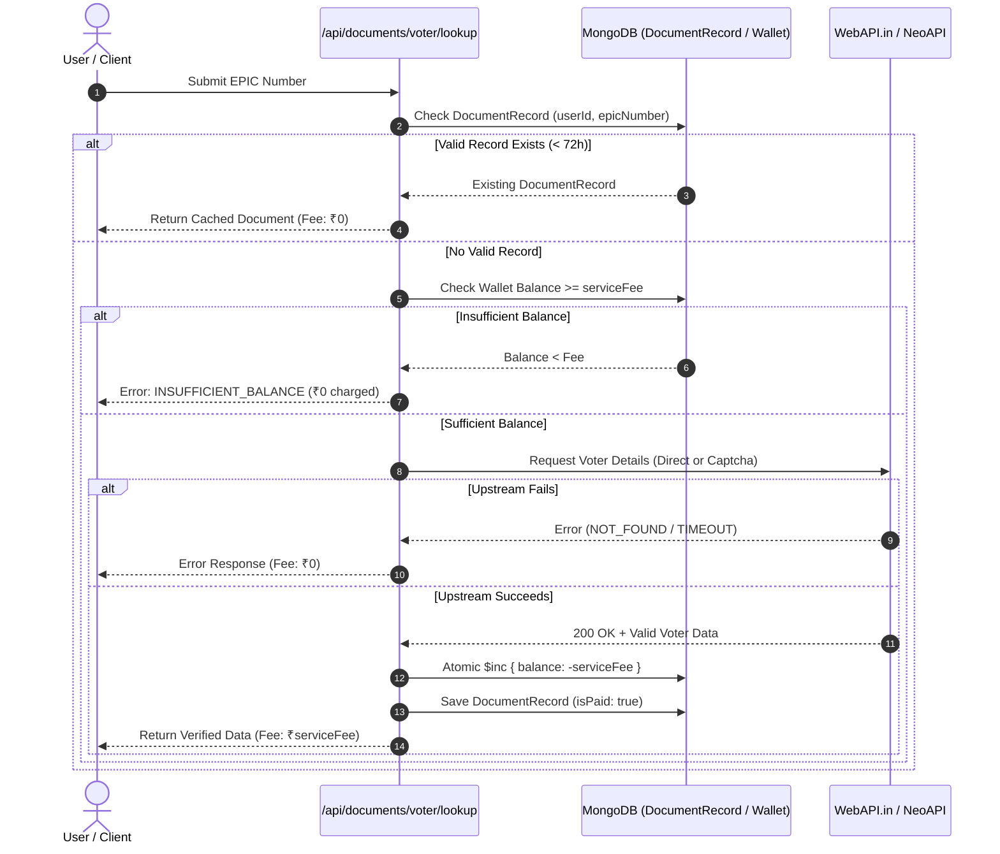

# Voter Lookup Security & Compliance Guide

## 1. Security Invariants & Threat Model

Accero PrintPortal processes government-issued identity documents (EPIC / Voter Cards) and handles financial wallet debits for lookup services. The system operates under five non-negotiable security invariants:

1. **Zero Egress SSRF**: Outbound HTTP requests can only reach strictly whitelisted, pre-registered provider endpoints. Arbitrary URL fetching is impossible.
2. **Strict Secret Isolation**: External provider API keys and tokens must never be sent to the browser or logged in plain text.
3. **Citizen PII Minimization**: Personally Identifiable Information (PII) including EPIC numbers, elector names, and addresses must be masked in telemetry, server logs, and error dumps.
4. **Idempotent Financial Settlement**: Every successful document lookup is charged exactly once. Cache hits and failed lookups are charged ₹0. Upstream provider accounting statements are never trusted.
5. **Secure Ephemeral Captcha Handling**: Captcha challenges and solutions are ephemeral and handled strictly server-side without leaking upstream tokens.

---

## 2. Outbound Network Security & SSRF Prevention

All external HTTP communication is routed through the centralized networking layer in `src/lib/network/`:

### Whitelisted Provider Registry (`src/lib/network/provider-registry.ts`)
Only domains explicitly declared in `PROVIDER_REGISTRY` are accessible:
```typescript
export const PROVIDER_REGISTRY: Record<string, ProviderConfig> = {
  neoapi: {
    id: 'neoapi',
    baseUrl: 'https://core.neoapi.io',
    timeoutMs: 15_000,
    routing: 'fixie',
  },
  webapi_in: {
    id: 'webapi_in',
    baseUrl: 'https://webapi.in.net/api',
    timeoutMs: 15_000,
    routing: process.env.VOTER_LOOKUP_USE_FIXIE === 'true' ? 'fixie' : 'direct',
  },
};
```

### Static Outbound IP Proxying (Fixie)
When upstream providers require IP whitelisting:
- In `production` and `preview` environments, `providerFetch` routes requests through the `FIXIE_URL` HTTP proxy.
- Prevents origin IP exposure and satisfies upstream firewall requirements.
- Fail-safe: Direct connections are rejected when `routing: 'fixie'` is specified and the proxy is unreachable.

---

## 3. Secret Isolation & Credential Management

- **Environment Variables**:
  - `WEBAPI_IN_TOKEN`, `NEO_API_KEY`, and `FASTNEXORA_API_KEY` are read exclusively by server components and Server Actions.
  - No secrets are prefixed with `NEXT_PUBLIC_`.
- **Administrative Redaction**:
  - When returning provider configuration to the Admin Dashboard (`src/actions/admin.ts`), credentials are sanitized:
    ```typescript
    function maskSecret(val?: string): string {
      if (!val || val.length < 8) return '••••••••';
      return `${val.slice(0, 4)}••••••••${val.slice(-4)}`;
    }
    ```
- **Client Bundle Verification**:
  - Next.js Webpack and Turbopack build configurations are verified to ensure server-only environment variables are purged from client-side bundles.

---

## 4. Citizen PII Protection & Logging Hygiene

To comply with Indian Digital Personal Data Protection (DPDP) standards:
- **Masked Diagnostic Logs**:
  Logging utilities in `src/lib/verify/providers/` mask sensitive fields before emitting log records:
  ```typescript
  function maskEpic(epic: string): string {
    if (!epic || epic.length < 4) return '***';
    return `${epic.slice(0, 3)}****${epic.slice(-2)}`;
  }
  ```
- **Zero Raw Payload Logging**:
  Upstream JSON response bodies containing full citizen names, family members, addresses, and part numbers are never written to `console.log` or disk loggers.
- **Client View Sanitization**:
  Only the authenticated requesting user can access their retrieved document in the Studio UI.

---

## 5. Captcha Security & Ephemeral Challenge Workflow

When WebAPI.in returns an interactive Captcha challenge:
1. `voter_captcha.php` issues a base64 JPEG image and a `captchaId`.
2. The server passes **only** the `captcha` data URI and `captchaId` to the client modal. The provider token is injected exclusively on the server side during submission.
3. Captcha challenges are transient and expire after 120 seconds.
4. Captcha solution strings are treated as transient inputs and are immediately discarded from memory once the request finishes.

---

## 6. Financial Integrity & Idempotent Wallet Accounting

Document verification fees are managed with atomic MongoDB operations:



### Key Billing Rules:
1. **Zero-Charge Failures**: If every provider in the cascade fails, no wallet debit occurs.
2. **72-Hour Cache Policy**: Repeated lookups for the same EPIC by the same user within 72 hours return the cached document at ₹0.
3. **Print Entitlement (`isPaid: true`)**: When the user opens the document in the Studio and clicks "Print PVC Card", the document already has `isPaid: true`. The print endpoint never re-debits the wallet.
4. **Ignoring Upstream Accounting**: Upstream API response fields like `debited: 2` or `remaining_balance: 4980440` are discarded; PrintPortal enforces its own configured fee (`ServiceConfig.fee`).
